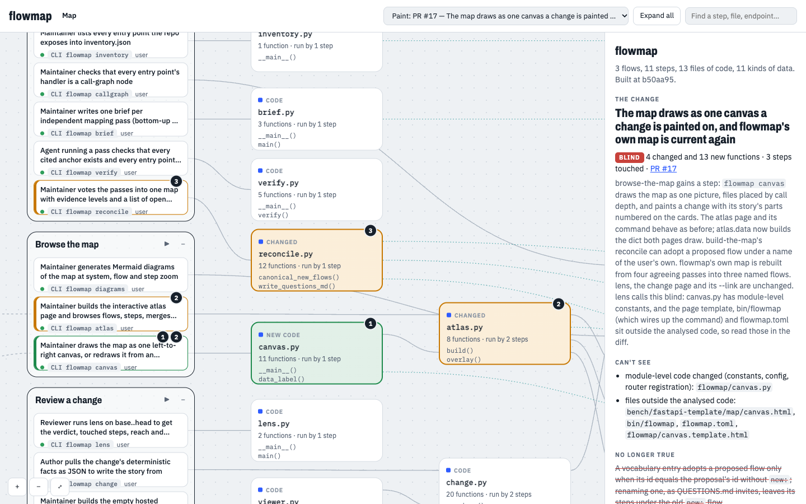
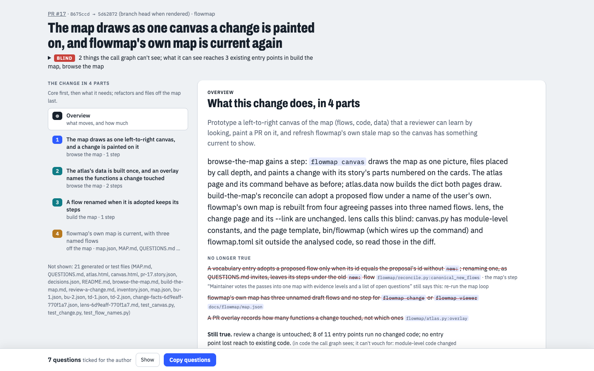

# flowmap

When agents write the code, it's easy to lose track of what your system does. flowmap is there
so you keep understanding it, and each change to it, well enough to stay in the loop and take part
in the decisions.

It works by giving you a map of the system in terms of what users do, then showing every change
on that map before you read its diff:

- **The map** describes a codebase as **user flows → steps → code**. Independent agent passes map
  the repo separately, flowmap checks their citations against the code and votes them into one
  map, and what they disagree on comes to you as questions.
- **The lens** places a change on the map: the flows it touches, what it can reach by the static
  call graph, and a verdict: *contained*, *spreads*, or *blind* when it can't see.
- **The change page** tells a PR as chapters on the map: where it lands, what it changes, why, and
  what to ask the author.

This is flowmap's own map, with PR #17 painted on it. Click a flow to light its path, ▶ to walk it
step by step, or double-click a file to see its functions:



And this is that PR's change page, which you can [open in your browser][pr-17]:



To try it yourself, [open the map in your browser][map]; it runs in the tab, with nothing to install.
There is also a text version in [`MAP.md`](docs/flowmap/MAP.md).

## Install

You need Python 3.11+ and `git`. For a call graph of anything but Python, also install
[codegraph](https://github.com/colbymchenry/codegraph) with `npm i -g @colbymchenry/codegraph`;
without it, lens says *blind* for that code.

In Claude Code:

```
/plugin marketplace add NelisVerhoef/flowmap
/plugin install flowmap@flowmap
```

This adds `flowmap` to Claude Code's PATH, along with two skills: `/flowmap:flowmap-build` and
`/flowmap:pr-lens`. On a machine without a GitHub SSH key,
`export CLAUDE_CODE_PLUGIN_PREFER_HTTPS=1` skips the SSH probe.

In your own terminal:

```bash
git clone https://github.com/NelisVerhoef/flowmap.git ~/src/flowmap
echo 'export PATH="$HOME/src/flowmap/bin:$PATH"' >> ~/.zshrc && exec zsh
flowmap                          # prints the command list
```

To update, run `git pull` in the clone and `/plugin marketplace update flowmap` in Claude Code.

To have teammates prompted to install the plugin, commit this to your repo's
`.claude/settings.json`:

```json
{
  "extraKnownMarketplaces": {
    "flowmap": { "source": { "source": "github", "repo": "NelisVerhoef/flowmap" } }
  },
  "enabledPlugins": { "flowmap@flowmap": true }
}
```

## Map a repo

In Claude Code, `/flowmap:flowmap-build` runs the whole build and hands you the questions to
decide. By hand, from inside the repo:

```bash
flowmap inventory                 # every entry point -> docs/flowmap/inventory.json
flowmap brief bu-1 bottom-up      # writes docs/flowmap/runs/bu-1.brief.md
flowmap brief bu-2 bottom-up
flowmap brief td-1 top-down
flowmap brief td-2 top-down
# hand each brief to an agent ("Read <brief> and follow it exactly"), two models if you can
flowmap verify docs/flowmap/runs/*.json
flowmap reconcile docs/flowmap/runs/??-?.json
# read docs/flowmap/QUESTIONS.md: name the proposed flows in flowmap.toml, answer split votes
# in docs/flowmap/decisions.json, then reconcile again
flowmap diagrams                  # Mermaid at three zoom levels
flowmap atlas                     # the interactive map (docs/flowmap/atlas.html)
flowmap canvas                    # the map as one picture (docs/flowmap/canvas.html)
flowmap canvas --link             # also print a link that renders it
```

`flowmap.toml` is optional: without it, flowmap auto-detects adapters and the passes propose the
flows. The docstring in `flowmap/config.py` lists the main keys.

## Review a change

`/flowmap:pr-lens` turns lens output into before→after per step and the questions to ask. By hand:

```bash
flowmap lens <base> <head>                           # placement, reach, reach diff, off-map code
flowmap change <base> <head> --name pr-123           # the change page (docs/flowmap/changes/)
flowmap change <base> <head> --name pr-123 --check   # the story's unbacked claims, as JSON
flowmap change <base> <head> --name pr-123 --link    # also print a link that renders the page
flowmap atlas --pr '<base>..<head>=PR #123'          # paint the change on the atlas
flowmap canvas --change pr-123=<base>..<head>        # paint the change on the canvas
```

GitHub shows committed HTML as source, so `--link` carries the page or map in the link's `#`
fragment, which browsers never send to a server. The static viewer at `flowmap.testabl.ai` renders it in the
tab, and nothing is published. To use your own copy, build it with `flowmap viewer <dir>` and set
`viewer` in `flowmap.toml` to its `change.html`. Links are limited to about 60 KB to fit a PR body; past that, they
leave out diff text and the page says so.

To have Claude Code post the lens summary on your PRs, copy the hook block from this repo's
`.claude/settings.json` into yours, pointing at `bin/flowmap-pr-hook`. It runs after `git push` and
`gh pr create`, and keeps one comment per PR up to date.

## Supported stacks

| stack | entry points come from | call graph |
|---|---|---|
| FastAPI | `@router.<verb>` + `include_router` prefixes | built in |
| Python CLI | `__main__` scripts in a commands dir, or one `main` script | built in |
| Next.js | file tree: `app/**/route.ts`, `page.tsx`, `pages/**`, `"use server"` actions | codegraph |
| Rails | `bin/rails routes` or a saved dump | not yet: codegraph and the adapter name actions differently |
| React SPA | its backend's entry points; top-down passes start from its router | via the backend |
| anything else | `pattern`: a regex for its registrations in `flowmap.toml`, or `list` for registries a regex can't find | built in for Python, else codegraph |

Most new stacks only need a `pattern` entry, which the `flowmap-build` skill writes during setup.
For what a regex can't express, add an adapter (contract in `flowmap/adapters/__init__.py`) and its
guidance in `STACK` in `flowmap/brief.py`. For a language neither call-graph builder covers, add a
builder (contract in `flowmap/graphs/__init__.py`); `flowmap callgraph check` must then report 0
broken.

## Does it tell the truth?

The claim is that a reviewer can trust lens when it is quiet, not that it finds more bugs.
[`bench/`](bench/README.md) plants 26 changes with known effects in the FastAPI full-stack template
and checks lens against independent ground truth. 16 of the 20 changes that break production pass
the template's CI. Lens says *contained* on none of the 20 and flags 50 of 55 affected endpoints.
An LLM review with flowmap was right on 13 of 13 subtle cases, but so was one without it on the 8
it ran. Full numbers are in [`RESULTS.md`](bench/fastapi-template/RESULTS.md).

## Development

Run the tests with `python3 -m unittest discover -s tests`. There are no Python dependencies. The
plugin only refreshes when `version` in `.claude-plugin/plugin.json` changes, so bump it on each
release. The hosted viewer deploys from `fjall/flowmap/`.

## License

Apache 2.0, see [LICENSE](LICENSE).

[map]: https://flowmap.testabl.ai/v1/canvas.html#v1.7X1be9s4kuhf4ed5iL1LyZZky7b6MptNp3t6J-n0JJkzD0k-ixIhi2OK1JJUHM18_d9PXQAQIAFKStL27Dn70B2LBHEp1L0KhX8eLdL8vjyavPvnURIfTejnZLZJ0rhXLUVvFa2PwqM7sYVXzadVUqUCnv8nPg_gecDPy81qFRX4xctoHURBIdZ5EJUBjRT0vg_KSqzpj3kei2C2DaLbQoiVyKpJkCZlFSRVGcCvYhus8ySryjBYRlkczIpELMqgyoMki8VawP-yKlhHZSmgyXwp5nc4jaQI5kkVVUmewWP88GNeCXyzgg_h6zyjqcLUlptVlAWlqGAlZR_njlMDaByVNhBOcV49mlOP54SNG21oBj2caiqKshcVopfBCl1N74ukEj2ceo9X5WjzURTJYkuNHG8LMc-zeZJyLzDIh_AoLqJFdTRZRGkpfgutHS0A9qK9pc3Hek_phXNT3wh-zlCL8f0keCmKVZTEQZzAXkarMoiqoNwCNFenOP4pwjX4R56vQvoWACiKaF4lHwW0TCO5T_gqFYuqV-W9IrldVsE8yj4C6uSLoJwDjuCG0haFjDv4URxVUXPrrGWd3ooMRgN4q9kxOO1GDF2ajOs1gPa-x7PphnQhPibivhf15oAIt0KDuv1cwfo1vQFs1G9qYL_dFBm8-fU1Y65qA0h_Kyb4Yw2ABGhn82VewGZAG7lnQRltk-w2uF-KAgAO25EgId0vI6Qv2Q892DLw6Q2OUd6FwSya30F3QJsL2KaSGqRJdhfNUhEsinxFw8C0Znm8bUC_sdLTYpP1Utg6Amvz5XqTpvLvHg3lbMWbg89E0QL_Bz36P_cg24ncrH0I3MH3nO1w4328M4tWglghtIX_REEsDvgbkPfW5HIEUeKV4tM6B4rmLU-yj9AoL7b9v5d5Bh0CkPICetyUAIvwCCAFbHCOYxAbjfFZFqvVvjt69uJnYr2IE7ozBCLxIGoS5_PyVLY5bQwIDTcJNIJ_FWfDTxaTut2auivynAdsd7TeTm5ugD9kNzfYcpHt124epWkph05iWOXR5AzWn5Y5fl4vMjzKN9URz-Dow28HMGYfMnRwchdOdDQ_DDWoI5BwSIotBHlSBnKIICmRFQB4esDP1ssAR_tC1MDeqDMLNby7r5v7dt9s0LX77nah-_0cuHMJQtH3PlmtAQa-t2rtN6zzGBj2pdP5EH5mD3LC3u8PW5CbUH6i5vgh7l4of4v4VtyADIcHhJeiuFnkhYUh4RGNdBNV-s8FKBz4YgkNJN25CK6t3vgozaUIuUjM1e4w2mKcJuWPegjWSEiGIgkfrlFi4iDB8SyvqnzV26yDvACxuO7F-X128oVERgN38F4QleXptygwk_j7PrXur2I_D-YWHgpUL7uor90mbL_DN67nH_N5NNukoKncVOJT5Sao_UcwieDwsd24n-ZRvFs-mJq2D1FtbdyFonaLPZDz6S2iHex2hmgXMeK1RQAYM6CKsYoHugFpD6iPtTUIEAvrNJoTDn4JmvJK9hME3NaHg_ptFxI6GoWOl3JWrlcMnJv8zvlWr_PGwiVjWD_6HjY3E4UPnPjBn1qrcn_dDZZOwvFx9pbZ6aOXVkM30TiaHcbW0bYvSXfmDmwT_z6ploHCfbAtP4qUiSdiTwMYljnw_-C_N6Ikh8EXUo5eTgeTf_n0V2Tqof30L399_ubtz69-eeN4B__tUMb1uD5CNBt00aK7Xeh-32DO1ru_ZgDOH0G-9hfwv92tbot8sy53t9vgX75mYKDnWQJUfJOJe6kVeZr-PZrPo8I7Mdg44Lo3pjLkbEd7DGBa36zi7jYaxTpaRnG-xmE7Z76OquVNIW7FJzfLOnwLTe7xuRv8hX3I7f_CXhg5PqsTF-p8VkcKsT7r4xbafVYvFlJ-QQ8Wynr7OZyGuxFmT1rft7sDeMLv2uUuDP-sTncg_AF92qzna_S4kxD25bEmw-tQ86W6ssv3aygsu93ELje5s6GltDS96m2tRXVRtj3noJIoF652ooekYJDioj3pX6ip6Ln7FRXV5PRbfPK9QzHRLV4_f_rDy-emrXrUbIM7-YP6m0Y8aqkxRlunFmP21aHEOJuF-8xoRyPa5R1tcIPcgvnzp2WS0BfO_ut0xYt0E2PdiHAXukqjmUiRDhLEoBJskspNrWYQxkundqTGSaF2kwNpkz4u3XEqCrwEHIzEjmRUU0elVqK4FWxhzL_cJ8sL8BMove8vq1XaJjt-B3tGyzH2k1_AxqxTYED09QTn-qON265mBXrKipe0xh1NS5EKcmw2KFxNy0nees4dtN1uE-67ZniBwULX88Ummyv7r_Vy5V4wvMnBmk6jretVuU6T6oasU-drwJcbiSKdlDbPV2uwZjPTCUy-2PIUP9e-YECMdov1tlrmmXrtZEoHwNNkHXuC2vnJ7k046DO5PQd9ozbuoI_MLT3sQ73Z-3y2Aw2cXbjw14clh3bQRKJ3e1DIrjXskBwYirhn67z17Cb6mCdxkt2aL7WoaQY7bqT3wY5xcFg5vkmB4WOrmAMKOp7CcZHbpLJjIJY3mcUY_Yt8s0xus6jaFEIGw29AMFEwe7ua5WmJHThFnplY4BV5ZiOPyLObHCjy8OOyVjs5SuLKxAgxGlIIbp9UnAoQZeyWJi-2lpJfHI9UuRYe4ccNPNJPvmxbufKFLaxwObvaALeAfX9JAOxs6JN8ekqecKmacGestNUo3L1kH5-pP8BdvJF71n7LUWHXm3WUWHKJEzTwDeaKOF_wXzebIv2fL4ZrQCBkb5SW64AvPLnhdB8vgCkg2_H6PkrvnK85MeqG3Av-Xepj5PYmX_xOWsQhmGkHu_dC2r0-ceHzgR-qBIiDPmIq2OujBoEc-I1BO_-rV_2uetU-zM-g-UM_NfjBoZ8avOLzPiU-cuinFo9xf9yUBT7-87_q6-eor1EWpdtS_C6KLKVFfL4-6033rLXZjoxQZ3Ks2cDUZNs5tFKV5RRaUGQxgSbAL0GDDWZRKfr9pYgoL_ZWcIolcKg4mVchPNvMlyJWrptCRPMlu3YAmvB4nVdfGg6mNeyVRoEtfbqhfNelGbaahK1XUvY6hPfeH7vRXuGmGx3aCb5-vHAlA7sRxNVyL0x5uqkwjQa_Z4OHGzwpg1hUolglGRoyc5X2XAb_9ebVL4g-tIWc-I65qmT5fKmJw3PrMHE4Sfv0W5z89z5ThxqZO9ywO9R7t92hv-6yO9qNQt_4rhfmDjXeJFXF7OvO3SVy5v0NCSs7knkpkbUo_fMCbrspOxus8nhjq-6NBph-Kxmya4kg-O7sHIj67XKT3Wnu7X7tfoNpK-UNZaA635v8e6d9Vn8Wbar8Rp0rcLZISa5QEvkumPZBObKcynUzTGq7AUyKk8XC2WBd5LMUZKLb3DgAIS11ZV9cPfQjA40P_JQxfK-PdloCHRTnJ4w9O3ATzed9LAnq8z7WxHbw55oQD_3SINLP-fTwr0ziPvTbmvA9XzpZbpdl6uXGPrZx6NcGS-lY7W5GbXEdd087uJfFlj6rh5pvvfsctmei2s50fuFM5_9dbQVkGmr2X2opWKe6_Fqh1cynEDYa7aULumO-YrWutsEyx9yUQJoVFPUFJTAW6zTfom0RgRoYoaKIDQ09MIpXxLMPy7fWB9tqRfDbOCm-V4ixS_OT8kA1a2RoK9J2Z2hrwu_K0G43crEOr4vMnF-4Y_5OnpTjcURPhvYBc7PSpA-b9n6fenbk3d4wcaz53RcAzMlCPvwG5MgneYDqGif5FB02HqskjslR4zEmZ0lKax7mO9r_qN8B567x-KdY46BnuAz7JFo9e-txPfvG48bsG2__ZY6q7anI-cHYeTR9t3Fdw3xEMNfnjmp460c1rI1HDTgbb37nA0leiLQPlDURqz7ZUq-yflYv03zWWKf56l_20IsXROaBpiZwrAMHNXysxzWIGo8bUGq8_d8TCf-zTyR48clZssJEKjP9s8Yp82mNUvbTBkbZL__lskMPiEl1lLU4oGLFXonR9W4MaTd0ql69FfpRvQ_Go8YmGG_-X8_h-1r7VG_BgLbAEQMzdsP1tt4Y99vGHrkbNbbLH4n72qsemqvWgbv2kutXrfWar9yLNVu4V9pKePhdllknBJlaq3pmqqz1s5a-Wr_6KrlCXz8n6H94kozPGOxAiSbj3VnMxlI6tbFuKJ36maF0Gs-aSqfxymvHH5ag9Xn2v8t-_0pgO9RsYXaqgqw1aNWTGrD1kwZY6xefH3vdp0pSy77V8TuDTehnBpswnjXZhPHqXza09_9vWO5fOPq227XVhdNfRLJD8lJxHkm3_2hi1F_ztyKHNLQy8TyhAmxtVxdt_OTd6CwcXaPbtUACW1bVupycnt4m1XIzQy399BeRJuX_EcUyF4vTH5U7Is1np4touBhcXZ-fn8UX16OzKBbD-GI8H1-PxNXF_Oo6vojFZRxdn7om_YcXo7Pei9H10W_hDudTc-k-F5V_6U0_mVz6YHgZDi4uH2jx5iT-8ALG7r2Awb3L1761zuUbHjhevumS8ywfyBMeUz4QhkfCYB0VpZDnHuHNsyijIAGX3UJ1g1PgKXfIWavrj8ET5ENPJsEWSBJ_VPy1iOEZVrrEuWDplnxTlUksjP7JWY8Z91keyFgOT0jWh0mBcDYYmtiKKjgWn9ZiDiw3DHCMKFhEm7Q6gSFB0N6JDEbDntVovDDotoKZljhCuZlzJbEwKLmMYBQTJ9K1GdUcyrVIU3qiCpIhIxEFACCV1QS5OA3nVGWb1QzaLLCQEpW1sUvWlDAj_DD4hyjyvomDg4twMDx_HBwcXAAODs-9OCj9t50YqH28jH-1y7cT--gBbGJSo91z5fQJjuVeJAWfPDxhkILepICdxBYMz67CwWD4ODA8uwIYDoZeGDa83J2wbHnEGaZtR7kHtgxIha-I5kESYxHad8eqD3nKOolPPjBVa54c_DsejDHhej0OB2cXjwLW6zFA9ezChGrba96Epcuv7hcKpjNfI9IZrHjwQCtWE0AkOsPlDpzLJbXUu1SptPIylQbrWCKTHSjgN0mMR3jB-I-NlV-Ow-vLB1_3Jezy9aVz1c0whxcAzYYKFu3nfrBQWwMa44vwcvTg0BgDN74cmdBwxE-acHCGWPxIb8V21N6PwquH0gD1-LD5o96Lq2v3cmVEyL9YHTKSm60jSK6FatwPjeKw9fovzsPLs4df_8U5bPeZe_112MsPAjM0xlCwgmV-QHAzLS6eoCF9WuWnCxnp4JyWJ6iTPVHPnqFa2We28QQlynF-R-nkZZ6dmDJjeB2eXzw8MIfXvRfnF25gWlFCPzwbwURb9KoIYyd6GWA4vwovBg8PhnNQRi4GHhbi5KPN95p5NJmmY8Xk5NQbPwqH40fYeOAiw7G5YncstbluX8TVzzqbYV9lP19dhKOrh1q5OQmwoK9AZMDg3uU7dQdXMNmtPzSWzNuO7KJsWNGjwdmjAICsaBjcC4BGPLwTFK3YOQOlHVLvBE8p0kUYfDJ5wTA8v3wU8JwPgSte7gEcmQawJ3h00kATQHU2wR4gSiqxMvHoYhhePA4ZXQCYLsZ7gImzIPaEkkqZaAJJp1LsAaMoDEy99Pw6vHgcQjsH-XrhJzNXBkgnmNwpI9KF5U4n6QQXnonTGs1rPCDHml4whT4m_zaVF7MYpbDT7TdcyQjrQJTBHEPkWNyBTj9FKxFo0W-qNxfX4dXocZAUduBq5N0BlVjTCfU6-4YhbWTjdEK3gYaj83B08TgCD3Tm0YUXCK30oU5oOJKNGCyuLKRO-GirIgxQbfruF0Apw69VX_ITRAF2HmBydjlRF_lAh4WosLhvtaTiI1EWRGkSleyujPCz11GSltQiWIoUy7ofz5ciWofBEvG3CtZF_ml70g_e4o84KRClV_IeE7n8fpWv0uAd5jh86OM8StuLdv6AnsiGHD87b3ki_QlfnbvaSA3jHW3mi3Xu5spE9cEoHD0Wsg9Atx11oLsjw20P0DQy4kwANZPldrLcMFjhLUUZU0wYWJ5KdjXe4BmCjbzeKhUFkEgiTLk_Gl2BAj18HBCPrlCBHnpBbKcGdkK3mUUobfJmbqEHpswrSFp9m8TfT9HGrl1YATrtMLbAIQeg9XVeRinwBaMNhxwka8GgS36f0YcUk0BXMApAejPlHkQ8DY4j9ggXAr_EK5IEtgnuke3w5C0D_2ocXj8Ok7hCb6GfRRgJmp37ZLRTm2Q92m39mC7yy_D66lGgcQ2Wz_WVCQ1nzmcTFJ7EUL_Z28hMVdb-5TgcXj6UVWPMASx-9BrD2L6lN_JZuwDQSn1lMLQzYt3AqDV1EzKDS4DM6FEgM7hEyIx2QoZPju0DGJnu24CLSgLeBRbgWaaCMR6Eg8fBGRga9Is9cIZSl_eCjExybkBGpT7vhozlQrk6C4eDi0eBzNUZ4MzAUjLaqctNiLiSm_0sxMyoVlQyPA-Hw4fCBTUBIJEhKJowsHO5nI3tXatK1uaF6tRtxyqlqChKiy_gigcPv-IBrXjgXDGlmXsXLJPQeb0qI33HcqXNg2pKtVT2NBdMpIKKoaq8iPVpgmOqTsL3X9b1Gcn8xvHAEMrhQQHKyNZSQgZXAyCYhwcmjIvU4gZmnZvvhaiZvs9gtRL6vbAFJQ60Nw3ev1GGCWZCINCyQHUSJKD56ew74L5gBoIxmM_LquBbv4pIZl4QJEN9TUx2x9dqgk7Ir7AuO2wgWZErVAdRLdS3NyZUe-inpPoTQNsOezxYKK3eFYx62JG05pEI74boIxPSAa5PUHRtBZ79RggCXL4Dm7XeFbyFlB1NKyGqCd_fSrkrfB0wlr2_z1EfX-W6KcUlkSKoELe6-xRziVDVC15l6VYmNeFmYse4lfN8k1Ww21G9-fe0e1xXC3eIz0zSBafiUzSvZD9EXTwfvC41oAxKrouKq5eZVXSB6jGn20BfVRFl0Dr5yIlTkRzmSSl7imA5UVBuZqWgC4ewYz6-_6T8JhD_vQFjZSWgDxxoi_kHQZRC7zG6LJ4hmNRsyWGBzjgwGFO-JsC8Jpnv_9qsZgiEY1CIF8ktoPGmWp4QMiN85MWjxH9ougnlYGGtV0xAa1gzg-HwwTEWTRkY14my6qyOF2frwzyMtMbhni6sLddiDva6pXeMzkEju3p4Nop-PBjYuX7zQJIXBvapJYZD4yRTh_YxGF6Eg9EjiI8hJtyN3OKjPmnlX7VRyVWu2azt2rn7rJgyp_pPpLxq2WOWgnQqkzH1rcfYvM7vZKlNh6mDfw_wfErJt45RGrMV_h8_XPjf0HHGzej_jjOHe2n4ZjnchppvVcrdrevLq2sZ-D9hkIxFA13jpvsibg4sdB3N7zDh9bicg5QoytMwmOHhkvL0_WZ4NhyfkIs44KMBLCVaOWxXj2JLcBqbRda-c3XNHfAX6pXqJxftVbB2n-ljmKMLHhB-u7LSbC_DweChoOKYHWbbYsb3wAUd-yyeBzR2o264mMf_2kBhPPyRiF-rhCi1I0wIf0LZ2JRHjhUDlfI4kZeno8KOuFtGW6qOHufCCiNcXYbXFw8LZ71aEKzoFbuwk3FbZwTbObiOY4RdpwmM84ua7w3D4Xj0YLmycgbI-oaYADNyL9mZ_9E6GOlO_nAucwB218X1IyxzgIbXxbV7mfU5Tv9azbOe0vQyT3-6Vu30-A6ur8Ph2SPsNAwMIDjz7DQfVvUvXx1m5aXro63-ZavjvswsfiHZT4ceSPrLC7zkZ8FzvqYXXsGjokjkbaVsG5ABBFYOaPw5KO1JJU0IfBsGMvxAIk0aPylexlDqEAZugBWDH4SD8_OH34AL9CGen7vhz0eC_fBXR4ZVwCHJqm74g-UiFfuQq7FSVDlUpX3tGPNTBTq6lwL6npBeAApcnsZkLnJdNDpnI-6Jg8v7nJCHc5Vg6Q7Q5V-f4EXNfExPHm_BDjK58UUsbTky_WYNu2pwDvL2evwIVHKOUvbayuZpnAhupUA2DwzzHqlDnToB0jhyLNXqqIrCQB_94614i-WXuaLaX1-_YDUZIUb-LBl-W4DMXQncpT98HPS_xRrO43MAFJIVnhAGKYx3bcRUmPf7fiOX7MGyLNWCZSKZB6bGYWo_ZK0T1zJn2zqE7YKykVM8Onv4RWNO8ejMTe7GOX8_zVvFAGoval0fwE_99wZpc1XmqL67BgOBSH4JIND0ryVMV4DwTqfkqIE2-AjNA5GGdON6xS4cZMNNa-F8FJ5fPTyVno8An648wryukdAhzc1CClKcW7UV_KBdJPEj4Zapz3TgllEFYoc8V6UiDKGuq0d0SHawJ8MAj4WDCMD8AMJHJVC0lB2H48EjCFkw5ceDLsBQ_YtdgJFFMkzAqLoZfsBkYUCeErC_LWcRGNTDxxBlQzSn7eR2T7UPPzgaRUGk16hRKcQPEs7xZ070hr4q0Z9M_uiczskSW0E1g3jPCn2yyp9x-hQLhZ7-W78qPyneRI8CnsDJN8CeYA7A3XJZf1Sd3I1kE-VLBj2wb-UMheePQLUjZFtnHQqgLq6yQxE0irAYCqFZmsW_JQ3HxsV5OLh4DOzE80sDO226VSWkCQZHGRG_nW3ULdHhJRRXD-VdkONjfInE1YVrqU4L23rps6_r5fG-ohYYBniTx3dP_vT86Q9P0Ol68_cyz777MUpLkzefX14BHM4eHA6XVwgHmwDatVVauO8qv9LhXjHrvqgFD0DvHTyY0a1mAEseoOY7GLmX7HavNAvKeNwrjmWOxrDMs-uHX-YIvUgwsnuZ9pUm_vo4Ug9T1XJcK22iuuk4HIXD0SNsMRI3DOxZulHgpwMAVhkgCQa7NJAfGE4r8qmMybPOTonjv74OZnm8nYCgLKvgP__6w0_P34LuJqKPAqOaVJ4iYDdvlmc9ctKyE4DCPGzcl9EWnS_SikeR2w-OAeAhe3cx6VOFSUE6o0kKwhg1Q04AEB8pCyBit2_2hCZnCWaw-0cXj4HBaPePLjwYzHWYOihV1mkysgC6N23xSXpl6h2rKoyV8506Ve50o4C-kxlpMXzJDu0gVUbB65tqt5f8yIquXQCNXF48PHRhYMwsvPBWubCrNHcWuWheWcMwb11k01k-RKbQFXPQ2BG1ORdjMKx1VbzoS6jgJqwElc5ijlnV9AHom4jV_UYJhNGjFLugMgijDt6r6oTtYMF1OTGDExs1xvzoLJOCqCYQmYTk5bV8WvK-NpllEsWxiIPjHK_VzddrEZ8wpFf5R7xtLImfyPyTiXYVSw8kFbfn2wXIM8G368oP1fkBJCCaB35J57MyERW4n_C0H7zJ5RecwaJ9bOuoqJg9rSIMr1aczELvZeY8tpDcD92fls9yjNkQw4enLhgY0yGGXRggC8HtwgBdL87EgLqInB8DMssrMrgahoOrRxDGMDCA4qqTGHTJu13AMGrjmeAwS-b5AVIapYkU_vc4UpoZaV0gVEs6mREFXDcBs76ysio2eFkGJ0YR6eA9GxFTAtVSsNJwMB3lEYQmDIz5KD61T1cP7NJ86gqDSu8xag76wWsXDxhdhg8X0TGUBtAZGgEdV3VE__KtEoq8fruqoh8ASwu78AMZZEFdDzsJ8OqZknLcUKsLkmyeboDrnkyCY0A91qHR9wJqtJUcOx6F4_HDA3MMKsJ47AfmLjjaIDzEgmAwvvsntgfRnmJ1OHEvc1x_-8D8fyjzWkEcSYhafvDLcHz2COYlIODYY0-bVTb9kLNrccqEQLs-px-KMimkiuhSVAbjD7kM3sZioZlcUdUJwYSqxzHGICJicWRenAQ4KsZwcdg_mnrVRXj1CKC9BNbmc1XUBUr9gLVufGKvqVnWtJOzhUE73eapzK3BhJsVXsMZ4LUvfKoPr2GVWb1ZVYCQktoSUL-yvUCMtAskwlA25V-Hj6G_jK97L3zai13t1Q_uZlVYeXqyWSu2yyIzkhXYtJpQWrX8nFKqZXZyIy_BUk9Btn8jE93LyqpX2aiONxyNw-HFI2A2DIy5MB7cNorn-qFtVdjV4W6j6O4elm-ozdowuMvAYrWPJ9QGLmWKVeoZG8hxjs6DWTS_m2hPhBR48JMkWxYHvR55QQqxoFq_wXMq_ogHXGVGvEjBCCk3s7-LecX530vMZc-pZ8pgXySfTupan3wxbiHWER6Ql8pYsrILWF2Ho8dQxoaY3zMaXe-2A2XR4_2sQV0huW0T1sWTO-wCy0C6Cgfjx9BTx1hkc-wBjVXo2Q-URj1oWWukUSTaDwhsCdz6U0hmaymzZ8wMHIzSU-gKY_QquUnxFQpsIasnI4EcEPhoQtKUrGH6iwQvOvKIFiy8vLoIh9ePoNcNscjU8Nqj2aki2n6412W2ZairLrvdAW1OUGLKVuIUaNkCyCAcXg0fAyCYi2gXDXBcHuBPhtmvUqMjEWY8DB8sx9RIhMHggJ1h2rgOwb_UzhCIa4lY4uj6ERKcsL6RJ7vUrAXvj-vatxVaKU7qBkNXTLc2AUkEkqkCil6dLYalHNCVFpfyoN6TOn_M4g9noI6cPUIuDwyMealXbv7QCTzPVY_dwDN4xRcBj1NOpfuylRg1Oh-Go0fxSWCu3cj2SrQuGelIYeQGWqtTPzvSGCWElRyrxGqN2Ydcd8gC7CLPuFY7n8otBBWM0cdIn735VUas8mKG1UaibCtzfXEP4Ass4V0KIQsf0T6BdbmluiQo-qpo1kjzGD0CM8A0D9TD8EJfznlBgG8m9sEjBSe9Gd4GzYvEjBfO68Ss9wVfZYsC8UfW1gosYFa81CdXRQoykq4frmcg6bNjjs0WrbuY_LN0NZDTxPPI1NUWLKeX0dqcH0xQnTeP8QxL6bgXAtMd9GS7W7lua5Uv6ukY3-O1G3IhXd3iLO1xsdDR6bd4d00Sf9_nes1GqaX9Wtezdb1zTpi68s3aM0x79i-f_toxW_m2np1-cBAM5Vft0f_y1-dv3v786pc3HXOw2tQzaTw-aD7Wt-1ZoSXfhWn6fT0b49FBM9HftWehzs6dfotPvu-AkKOlgU_GMzcembcfuubo6L5jtq-fP_3h5fN9Zlu3rGdrPvvC2dZdtWfLjNTSOvwtmvxZPjxon40v27ORDLNrOmaTFiv-nAmZnzpmxP7F02_Rm_J998wcTQ3ss566d1T24J2pYwCacft6-HqK7XetW8Kac6JPjEm0u0ARxZHvybt_HkXo8915VXd4NHNdr8RxsyNqenTo3d_3R5OBXA599OzFz6qGo1HBHiQ-T7I1-GwP4SknSIcLys-aoRr-gHu4Z66Ujn1B5e13B8T0cDXEdl-UreZq3BWx7zydt253TZBamdtpDDo7QMPYe0u9M_TBx7wlW0HGLAi_L2gat213AUVe6eDdstZFy2pejbJ9-07NdXFz1_x0e3PjGmPPOhSuvTfLN7FDRm3oUg86tqE5fbVx97jpWaGDXZWhAxv2uDq6Cx_qdjVw7LFneyp2XVDac5KfMwVTM_uKU9hxm_CsWbFk7x0y-9mxN7JRDRVjvA4sQcFx9PUuRoYZnndMwV3S4nebynD3VMwqEr__PDrcJ7PdeCTnt0kOxJmRFwxd9sL-9OHAUi9l2LcDz1q-4r1Jow3lDuWIW9VgMEf0UedONHDMoGsE0yn5OUPscwW1udldbrDZ7q3ZD9naMBj5YdBpDu6Pbh1w77iOWW1DfSTJj2pddzp3IRq38U-mfU2uJgHD47__vJzX7nZSArW1KMEY-AA8_To3BDfQpTUVtxG1ezZeuPgH28sh0IGjB09hJwy9u7EHYjj4gt8Ika1q2Jhjejn0gTjR2gDHIG0a-NqDuH0qB2yrczh0t8hyjfhVlEXptkrm2BVm48A_XMMRA1B0x0h-e4ttMW6g9hIswShNyqiSF-oISpYjrOHqpJTXQvEeeI1YWQcrcADpfkKfDnmP1kVvcAkvZJGBo19fB3-gBwVxgMnR1fjyYj6P-_26VzpJRdd01-IQfqm94CwPDrsReFR54Lo4I8U-PtB195bR1NWL-yoc52UN9kUDPE6NmvUg0JExgJF5YJemsIopGIWSVOUgq9iAdcBeRvlViZvWeWfz7DkFhSRK_XO3FVivAjBV0DXDH5PoIEAhYDqVNP8Yakv1RnZK3ybEZScNgLfgrkFNoMkxo-ndB_rjRqIg_lSYMjkPqfvJYIQYENuX37g1vfBIlhDCKeo_j2apzOJfU7z8psrdVlTo6jT0uUZC2S90xadQQFf4KFIuIadyo47pxESUYSRZVXSlsgAYYr5Nyqog0j-ZBNNW_sFU0aaVqklsppTpnPDZTGTz5ekiglHWSU8pe6cNTWsaQsskU4IOf5o35xi_m2ojf85IoVIvFXd5K6u2cH1rWf1a1rzWJa8SWbeJKixxPF0O9YRPA5LrtwzmmwJvIA-iW6Yy_ATrTh39WuRVXm3XWIYXT3D2qrxXYB0tNZQ8hoX9HBN9hLIKFOKfvGEb4_SydhFG6lMRFRmWe0jz_I5q6dIc-SwqVpuWh0oLsShEuWzMGGCd8ngy-1JOBG9iL3O8SpQynuWC8MDXMr_H6H8sUowSH9nEFeCKS1k2rMYE2evUKB9OuMpgXgNuy0rYiCKwV3MuiEyH1ah6KS-BFmbsB2U84NkydYSTogjuMlj94K2ucU7pEtghFUAG4YR_z8QSD-lGWGt5kRfiG27cp_yHLL_ntG6ZdY9l0Wc5jI5dcVX0fmDxRTpaJymM9olYP-ZqyEtduKLaBrME4CnKQ7X7m5JqNmM1DTd-FQKHquS1UfkGOrgFfs3Fw5EHc83SagkPA74whpCpT_p9aKRS26CQmbx4GmqTSbrnb-SBQDpaQLxiEmjiJlxp8A3NKVStMhpHEWIYGAQcHN8vk_kSNhPQM9isZfFK2pQTk8b4YqwyqfxMhPJYkDPKIukyYQVzNRFnD8tQQQX4lDSOdWHqH1l-gyXyQH0Cfvm0fbcPbXTZ2ukcS4TLe3tKvPGd6m0zPqmrgp7QC0RrPGhM9wxNv-FLf3BzqbQcANt0FGOoCbW-UB1RZnrA1HnGLTqcmcayt0DdCtLCqyXVrkKM2WSMM4DVi0rWP8d9yHLqmA5DTG2DbBqYz5g7IdN_SkyItStdEQuzv2F3t7ooukHSXOQulkdCCTHwZOkRi1N5PgFUxIzsgU7u7WKwKgnKxdABcqhd5tQjFvVFlZtYgTHCEnHrPqcllpPgpShAU4i1X1njO_GOUK4Ag3MlXwWAIKrrsdPCc9C8qYQO6tIgAjGHXpcKxLP-hNB51iRbTFwGk29DaXJ84JdwTLJTznIuEPMW0A4mQOXqU2bfsLOIwEctDs02RODzc0xkyZ8yNBCDVhNKkVnEui5-ByvXxfbqCpQ0ckh8IOb6BsDDePN0xeu6CnY_eJYm8ztVmRKaUkFKQn--ou_9ZngxG-Mb1Hkxx5CwFybDad9xvpkBy5qrbnDCKOCE4PJ_GjlJzKiT1TQxXAEXzi95hv1g2pMWVsAW93dUMPD7fv9bPP_2_VQJL6VOEUGJe5Z5IeBWcecsx4nlmkJ96NCsV8DCjvECLyhEKcfAvU2QEZiHZTTtFnTrpixe8P4IqUxiFmz0-yOJjbQcAvq3tUcV1gA7wxSWBeITIDUypVqkYiFi2FKWtKyE4O2GZb193Fbxg-Mpdy5_T0_4SI_Uds3yF2Y_U_J_SbY_VSQ2lTiKevs0AL6a01IR1enwCCVNar2pxI3j81qaF9AhdT7xLglIiuNyC5BbAZ-Ff5AQF0SQCRVJxf7vl1s6TpPj4XU5RinxEikLOCAntyZ4DLSQd0SY-gihkyGPM-qJZXw9nbXI16hL5Js0Zq1PH5nRC1sIoA86ViOLW5DoC15HlAoKSAVcLgP5TRsHKK6oqce5gEBDswIlmbrS8vmLP7MuoQ7mI9vRu4LlRVDXW1H5BuZjsiMAJlV_mAk6xRKAeEuYmhZ5qq-yYAFUkApETAGQ_k4w_mu9sL4PYyaqeyw3xprYN1JTKOneCFYfqAfUtuZFzse3tV0pDdCPqvhqg0AYt2yEVMi1AZDdiQbm6eIq5V2yritw94gHizhB7YeyahdKA5wJLW0iJGfsPRUWzie3WV6QEO8Hb5a00zZmV9FdbZLxMRVJFzg5TJymk1sSWfGEp_peG61TZOHRGkaZkqIW_PD07dPgu4Dr1k-pxgmVGecUVpytJnE9q5qaida4-iVSEN8IVFJRVFix1tPwa5yO8b3cDUARvANVY1VDtZBa6ZSOrgJMC4FSRVVnUQKwV1bb1BKPONgrPO26n1kJZhMAvlRSAxjBG9gMACThe8YHZ31SsbZOAlITx6QeB0AJVMuHOQ3J_5RKESgNT1HoH6XBnywSQWY4VkVB35f1TxFlpH7iwVNBGeMftMvrneVI-nBA9EEq09RFh92MylCttMMvMxLdERXZD_rsvAWlbmgrdYRiUq4glTNPBKtKnj0EICtpYpw49KqVtX5XbtbrvKjYiam1PEn_xF-mdOfDBqnVuB2L77sCHR0seQNnwdBA7UeNjAqcofhyte1YXgdEh9ubWoCasqWb1QYoil7ghZlhfuKn9nyl6qYnRWxBFvLuvsIL5lsDkghaFQifypneJHGJrhV03OGfcnjbmaUZpjEa89pvDBgywCSjQ_XGFNKvAIrq_PRCCKCV2syuhS3dHc7mzdRyfMl5NZRaWwCCwELDHLcDjFcl5FE54quJ8LbxNL9N5rirmqZCc1GFwJOZ9ZqelLWkQ-sAekbg3ROri4GspbhHYTUJrH01tlGJHfI2oJ3LK6wBIAXKbEO8D1jKDBSLu9JkxpnFWqv8VmDLliC0pgCPUX6ThT-tL0kktef4ZMpWBegAC2w2jUESgaT7BFD9G5X0gfWyF0QRJ-Oc4vNYBYM5vHELFqu3Bkpzn8izf8CDldCUnFWt3SX_UqV9BFS-Lah11ImcLNq8Ep3xHjANF3KgkGqiJojsFwHUYMDMa4nx2kxWxxU-fL0Ei5oFKzY4qtngU_fNv4m--FdqTNru38XkareU6sDvqojs643ZZ5FKlqgvOLYdFkBtymGB88ws_02n_2JROb0XhufCZI8O1wsKXfKkWdODWUifDFly-lpl1HnQMT_p9_vvj6bBMd3vFvORM7TZT6gUHD5KEBTEGuK6X7wimwvzm247HJ-p_e2rly_4UiD83lo0Urhm11FFx4oldWPhQLSZ6TsmzfscjUNad-0MmibxVPsHT9kjj9442jx2wxLw6kuk6eyyLG6v9CYs5_UpAqEsTC78Cw_BFj6Pjn3dAzlZy2heL2NwZ5TR5Aig3FkkhzCQxQWWmxWeMCMP8b00mwzpzZ7KH0FWxlJDlism7yPebIhqLjvH5W16-P9M9sEEXducartKWwqsk4ysIDZsjMvrEEKxmCcliWPMiVRSjdk5Wuqsy5HMeM-h0QJoE8xnIhraAXIhIDGhB4dIlyWIgbMEParoqDG0xailulzT7D16-yVtGnvLawcrX2PncRRU23V-EpqWawldZHjHIDoLlQ5t0JepsYOqVm3N-QJ5IIP-FRHUwgPYjxrXQ8mqSCFCJA3r2U_YZFTbTJyrJnmfFoy82GbCVmj2w4Epqi6FV1GP1kPPawbcFeIJVVm7hqe95sFqNIcvETGDZeZwIKUZUPltPgmu1K0fWTByuWNDfdjT65ANleHIrlnpkjX552Bg3dkYBvBAevLQnqeQAvnuEuDEa7QFs0rGFxCn7HAH6D92IIhDTlbuQV_bqLj36HsFGkRZkjdbtmmQL6Gl1Ur5nZSSO74_4qm-P5owMwX9JRbsZmZdmEIiFMsWsdb2TBczT6hiH1CSnTD_vsXa6RlXh8N75zmHNpY6htYY6WPydJInVj_iGC3XTGT9lwvTqW7jBOWAcgSBlZQXZS9FdwbVxORai1WuvXWL5BO5Q5ADmsz6WW3zSlcA6YZ5RsYmu7RwR9i7klH1ljyOqOQph1kM3s13BKGJVqAFk-hwHClt8BMFefAq02EFjknUdlagk2CCY7KFL05oHtjFoo5uAqSSQqRb3-qxTkdsWHKxSAU-ocuJgEa-0Sqi1POf8DfSX4ruP4PZFwKFLWskJQi8tZhjZx-jdENzZlYHCGDE-SK-RJclDAUXpJCz-DMFxzpRuVZZkUcAD6aAnaIjxr81ecyUvm8RUj_4MzJJ9odl5NAx7PDeuugt8_xuyo7dqZnHh4q78tttAFCzDWmNdHFsZpL-hMJxdF2wDKxN36FP7EOfEHaqtWfyZC3pkskANrgfvCR1mrUj9uv1Nus_dujS-h8MVtsODION20zad07BfWKj60SFnVJv8Zc6JEZqarNx62CWP-sYF1ieMpFTVfbeOL4W0WLRu7w8WwyiS56L1cxMs2s1pxE__IapJkZq1LiZGjU2UqPG1zNxdjbu92WOlJ0aZSUldiU26TQYTlRSiaddn0jv6JFMKbnBomlUf4fOL1E3rhR6b-bTmqve6aweukhxyUlLgCOo0nKJBLMMHDpFd2QteY-p-TOLjKQgNR2ayAHJSlRst-5RA6UjYdc_n52g3ienc3f3h6U4XboynL52NpM6KRi6UoNDR0Lz75XgJFH55ibJkurmBjOdwtZbE9H3S4Tqg2jfxKCzpptb4Mz8D_GBjuwl44LgOfo-QCffrsWbeZGsq9P_ehMGrzezbRj8lIfBf0Uf2YtJF5yTMaEniWIA5RWZ-bocPRVLl48DddE8eSFA8JoZTq_RM2b0dmxkWczzdLZdAeVlxbaGCmoPFYjGXonOnIK0zU9owIHaOjz7d1Qebjeo25ygVFf7yiHOGEs0gm2Iocg5l7Km7_Q3sgYKKQG_0kEZlQyFqo_AvBdelPRWwCaDgoHeD-nSgN7mdahPJT091S7Eut6w8lpK5x0Ww_6kfQM8NipL_eBvCLupXj9dCAbvfn369k8hS1MEQGlojBJjFlKa48UBskO1UGVaI8GjUAM7DmdNCihJb3K06TFB9XvzlxeoLsk9xxBfbedMQTOb_GUTpX20PKbyTmkV9Oay4-jlAXCHZviKbA5JnByjmIZmSKaRHsGBFUJWGbiDcdiriKCvkQhUlmV9P2I5kdk9DBYsTcM5SVShEz2xGMikWFFrOrUqI_Un2jUM4cG6cOe090ghu1SRWU-VUJdbHZpblBerCDPtYnkXI5EXICpPspFS9TpK0vrebmnHcLVF6GW-tHaKTfvjKeHFNPgI-0P3M_XxBrnyGRYjzTE3oc8NuJAij8AUYVhKqPxtRfX-qJ3WhTdXEBSVI3vq4G7srrY4GvmaRBy0GSuZbIosuI4qGV-bBZgy1BOKHiwnlCJ1R8bY0ivPnA_Ri5F6s1p_bh7X2MrjGrfzuGoLJrI5J9rPyDtZ_Y3Se2SHdAkErQ9h1kPMY__aeyoCpO1zgysfG6VhkUkhj9D0Ky8Nf39Euyf3BvGBEFI5ieqbF956cBg4aSRnZgwNtMaoy9Hp4_dHEpPJEHx_xMC_Rd8MPFS8LyrvKE9gRhFhYqSase5IyPqlZlEEDgJX1LrE3kRzwt7uBCyavAIhek-aRyD7wY9EbmiQZNvGnCl3C_aAuRlsAPExvM79F6wz_feyvuUMMOANWNHpWo7DhEOjoZ9BxR63BtKgt4vuM6C9KxVPsuJ57Tgdc4djwHP4XbLWcfp39Ye8Y54kP5gKeEWAZvR5zq4GTJjMKQhDlIee3fvshDl6RBmXAWh2LPTIRDQkPZB10OttBaZ9Ib7-8Orml1dvb96-fvrsz98N6Jtnr354_tPrp7_-Cd7c_PD0-ctXv3w36AdTUsynzME5u0Xb6mGAacN5zGqULrIfctFpimLRM2xIPEOKFn0jXUAWZowyZvp0MplNZQBJCqan_dm0z5yLfZugsiWRDPhyorMoKI9OBZ5oo3XqH85CZggxOck0YD1V4LXGL9ToEFJ4uuUf5FdTDFG9kXHR6Uk_AEQCpaI8TdCjvqLFyDlgNpicA286QZxKRAeiKNQtBOhzKCgmgxEQeg3yYiqNGhxJ2zqSGYNJhH-V96bTW5pGMuVSKEc6ISDliJcJ-ue1ml3eyYsBaVacCofqC14GDSJZkjJP_E76IwCr0C0l6bGl1xB6TTFPDHUh4Af_EAXonqzC8A2CfJURqnJZIF37zbXX7JC0UJZQx8hk0S2OVMkgZP6JnMzwdt9uRAkLvWXhrRgHo6vJelgCBWwBpdsJ576Q01VmNRVRUgrOe8O9UrikWtFdEyTM7lV21kdRy3eZUaO1BZ201jJplJrCoCBKAMPyTmSmw4_Criaca20d-Jal6yMzI21fMiriw6wVUEpTZGqmdQBHqQ0kd1Lm3TrHDOiiZAXLDEb-9yYR6voq0CWjgrm17B7XUxIDxswmMw6jHHOmCVCIEsBOgeI6fIgBDeWHnm_VDqR5xRl58AXqkRisorCT4vonoYobcX1JtOEr1likpfGENmi9gYn9XDHnkTpXlOJXW6mTETBqJVlremKFJSxRso3G9Z6TTww-T7V0idZrInFmbU1HIilskzpsLtQA1D9zrR5GX8mtVo9zPMW4Y3kzr_XAYjbpVBBxg2r0YWygIF-org7LN7dLFaNnUMjxAiwYmRjZn6xnAkToNoHXm6wDqe9tvCXH9FtSr37K2dmKCVPooZ7wfeXZtl4nk4HcdpkUyLfck6grlxFmqrHMLusbiaDHJ7H0-LLzlGUwycJ6LtV9IsOVhNfHyK25Ujne2xFKHWjQH8o0bpj7cDxihghoI6O40Xwu1sRMsMEW_bxphAUgK1oe1ZOWG0zKHGq6EZr7ah6nU0ZKJiw26BbqUlbcIkUpXaEy9f-2i9XjfPtdMxmMhC4CLe0fWX_a1GJ1oZGJi4l3yN5JNstLMjrTGp7JBG2KV3B5bnmXCMaSFiTCcwqKF4TenM2JzrIpY5WeHifHgGa0LjDLE_eKR9Hyk1BTpqE_zbTLQkrdUiV9EgekQDim_kZSx0XOU8lgvw53sdv956wEwV68ZnfTtp-Ub3itGOKdU1CV9PJWyykbWxil-qSmgYItX0uDDIF9Yimj9fJZ_EdaQPJlwTiK7GnK3h9EzIj1AmXK8DkxgYSZZzpSBZwaxS5Yg5z7aogq6OMkVOCs86hLlcvaDzgCxen2bJLoHaPZTpRtb-6SkUHNtfPhtcrTJVXPOLxl0bY0ITgnW5MdMp9CmfaoanPqlVkmntU1CaBYaV7olpBDGXoI2gYzip9_Q8hEMV9K6-JAG2ATGJWmiNcSWOtEaDGaV2BIouFgqEN0M_WjeTDbskxL4vroBSvB9FilMWPG39agxyelOvNAa9c5GOrjZcJdaUevEhiRTADkblj3QoOfHItyE63oHMoT_EjuufY_mBtM525UymKdMV5nypubKynTVDNAyaSkGYlmmNYmiZTutzsmsKoFKkJAr2axQHaC0Ncmc34SShcRkz0bt5gijBwGJL6im2N9y8zJtCXwn1o0wtTFJr9UZgIwIlAJZIdWTYvEVVidMfmazPYkaUSmKUMT0M_w1xjGA2YFkO3AVhAfO1P0TVuJtaTxhID0L0T3oT4zsUpIsQ50f1LxXSIbi5o35KDg_ZvtZV6Q3kAqAK3_GO0EdVSFbQWAcr3oQlSUj8rmQ5UAFkwN5sX-FLBBAGCISHN9fScOBPPbkWG9K7XaXfapDon5gpeOfL6_EQgtf7uEZqhVXbJ15CUptdd9lwT8RbpJK4zLAwog24ksl1PDicNqHGY0aE8W-VBhfCBudHp4HVbvjzQvYceT_MT2K5kC52-tMEM0K1XCRFRbhIRHbNTJULO0mWTyiDFNdkY21MwnZXvm_aqECaO7n5D8_dHxNFsDtQS92-A_3GGJqQwx0EU3luvqBL2nPv_bMlKnn4OzSZAspBIHui0vxnaLyVOVRiykBJEdor6aRklmctR77H2mdolklFSGyzsbTfrBM2LlhicPz8xSUlp9wJhxrMyBTVIivzykqLMQ3h-9QuLE5PQVkZNQy244ZTFPhcJDZ_1R_wxFhTZIVR70Zh3jMQJDvll4oIMuOiojtJ9rlVNSDWVGIbrMOYnaOJweSiFQjzoTyyRTFIAYE83vagn5jGJrwTOEPy9FuVpjAdNDAw1QQ1uaiaBkRBUFUkmAghLJMfUCTQl5nuo2zWfA_gm15HboFAzQBVZgR-J8JDyVF0DdIsYuFfmydtjBIou4h-62re61JN902fDUNtPc36D3I8_e4M1wQbaJOa-Kp1PyOxZkS6oXsF6LCJ0VMvmX9TNWJoCVY97vVnEq1sGk2ayTWIoe-61508ks-_V1UG5g3ci7pXNAVJu1L83RDLyQ_2qtrhwQlBSrcO546qHa_xj0x_0hxkDYq6QvtPI7fzAHnrSGEjpbRdoLhEILRal0gldSDJLoERkqpGTPgX2gtpau3VXiGZ0lsHx07jJcTlgRzQQlXPN2SD2Yd55VUGzabd11HQCyqk0dJLYOKuRrZOcQ29OpMMwLT9_8-ecXLzjPxTwm5I9rc37Lh9_-Lw
[pr-17]: https://flowmap.testabl.ai/v1/change.html#v1.3X2LctvGluCv9ChVI9ImqYct2aYtp7Sxs5u58WNsZ-5WURwSJEAREQggAChaV6N_3_PqRjcI8OHkpnLXqdhEo_v047xPn27cH8y8aZEf9O8PJl4eHPQPnp8_O5tO_eMXT0_9Z8-f-GfByfOT0xfH_uRk-uTs6fMXp-fn0xdnzw86B_PA86HFmX9--vzZqX_yZPbMOw5O_ODJ8dNnx15wDrBOzk-9E2hzfDKBFtjHKJ97ZT8CRgoFFBTG3gJHM4uS1cJLoQD_7g_uD0LscrIMI79bzIMuv8yLIM3p9U1wV31_FIV50Q3iIrvrpkkYw3QN_HcePMP_QaawVq6C2yC7U1RZUWUFUFQWpIkKvqZJHuQKChP46xYqJdld79c8iQFgEPsCvD84-OHnn5QMvax5MIRat6EfxFPs2rvOgsA_eOjUD3o6D6Y33bkX-1GQ5V0vC7px4gf1Y6fKOQzVK9ZncJgrAaPCXHlq6kVR9zrz0rlCiJvGjlWp5n5jX2VhEXRTL8-7kywMZvWDplq5SuJAUS2V4ghjP0hhPDB-BaDSML5WCEi1JklRJIvuMlVJpook7frJKm5vGj1B3W_ksHbh7I6GXo758hpHky3jGEfj8XjWl3wK0_GVF0_nMMDgK5ETrHsNSQEa0sibBv6m0fNQ9ht-FkyTeBpGvPgNxHKb4LIjWXMlJmhEA3a7Cou50j2qCAYf8TQ84hCVzFQCCFK_LYO8CJM43zQHM56GaQxxIszRWbLKg00s7VQ4ApQEmQdU5ocAzFvUT1XXytW7IFt4oa90dZwHLgGOEjCY30F_iw4NnGaL3at_JMli0_RM39uQ5I6dceYVkVc_anrPGIIymMC0CG8DRQ0AZ9cBjZCB5jSYvEMDhn8WQXYdMMKmW5ibB7Df0P3MW3WnXnzbMHR8n5cLy9wdBbOiWyTdLLyeF4pbd5CLs4Drh4WaZckCRs18Q2xmZrtZQNFQtlFXBm-DVdfrTkESEsQqeVVqHAG3d6Mgtmb5iWrAHOFVrvAdTE6hRuv1UIWBTAJ6Y30BvOuH06IDZUsQFL7GThZ40zljLwqRytKk2MhANIQtKKoOPV2CfOffXdbupSRbFiicsAZjiauBhvADILRFGOPqTxU1Q_T9x-cP73FiJKupRY6qjNC1ES-8znuOnBmDl3kbZwSLtLhT8yRHoSuYId6A0YIKiZI7RI8H4_VwRlhxo7TlTpsICcpnIMaYYlKvmCNBvL188-5tb4FS_AawCUV-MoUHz_ehVf-8AxNcJLf4-xgnLe0mAH1-NPNgZGnYBbEDuqAIjkjpEzn35sUiKoEmyyIPiZUF8POTkybQYXxUmkxN7U-t1idWaxh9rpsfvbv86ExNi1K_hHPy3AZ01gTpP395-_nLTx_ef94G7-lTC97Z8yZ4JBkqa1Q3ul1mWbvgNcCal9wFR3ScH6VZ9-RZL7ftw2bYp6dPdoHtB9MwR4W7HeLZTvBEeR3V0HHdctqDPHmyFaqrOLaT0pO9xuyYPduAnx6f7AW8Ipa2jv1sJ_BrHsOmAduM0AQQZ74d1IsXNt7OT5ugoVaDZe2ebIf59IU94dPzF9tgnu4yThvms-cbQRb-LsM8eWEv45ZRAsgdRnnmUNLpmS1XBFwPnJRNwvvkaQOxuOItvSthiCFXx4jnNQBEpjVDOH36bMsYBITWTd-ukAzAJJ6F15tmtQWA8SQ2wbCnZUsocACK_Og6iUCxH9mWUffcfxF4s1n32bPj2Yn3rEIB2K4E_-SJw0ovjpt6QKNtDbItRFy4p6dNkpWh4t-jGqS6UF6cNqygDYTlWTOQU4cJ64EgRkZomm0azdmxMxown_K7xSSJ8jKGU6X3PlTOIg9BoqlVzxEABQnQ1ETrbglADxaJH85C4lUglAJ9poP-zIvyACqF1zFUywBmDJZvafxvdsw2uD4wH_CT4yDnyFkzFOhjbZ6jEXii8WiEE62-o7Z1L3yv8OrK9VKAr3OA0Zog27TEAiXwMVRx0C-yZYC4uQlSpLAI0XNybLymxkFsQY9UM7iJg9UWtAwYL2lGS_uvip7dcKBhOEioLrlh9z4OZgvKNmDMDHgLynS9fx4__ZNxstvaW3D0gtKc1phgA0JSdEfXl9QW0LymuuL-fHDdUcLXHfa3L94ncdDRYQV62sQoO_OCXdFa93KyNQu_RppNS7QRJb-TwMvmFJ7urbzoZhecOLX3R0zcUT6ixJve_JXXn0P2nc2rtSN6NKxvxQ-ZC0VYRMEu-HFq74-fGQziXxIv1rz_JLwQj_YQIaNktrM4sxrsjx2E85eXWp2ta7UjgjS4b2acLFmMJP69nW-syt9gd6GR_xfGTDm7P0en6IFsW3Wpt_-C_1UWe8flrDGb9l3SfJoFQTy6zpJlusvSVurvv8RZEP1rqgJn5n-SMrDnsA0zVt09sLLZUfgnYMNduX0Nyp1tyW-iTeMR_bWp88804AN_N0Xn1P6Gle-oSUdhyArM-BD-irxJEP3lHaptBj2tx58kKzDUMaJl2wVfTu398bX618SKNet_KlbsqHjf85MU2lKANl_HTSWCzuiptvm9pszmbKQKkjZXthDlTLMGV877Crqcd7DeSRzCco5gfuVCbV_NjVjcoYvfgVZKvRiZdKvRwt8Rt7UNf2-A7y-O4Jo57466iiKrjQxuQVYDge2ArfqW_5-jq27Sfyy-zrDAyvq51ztUTXlkZtcKbcYiKbzooH9y8oAvvOkcAVxjLhJUuIfCCNOK6NfUW2L-dP3rB_jNiaH5iMsQOmptZ0iDvXccOoPdt4pmy3jKGZt7NeOMwv3amF2pfRrlaRQWI8pO3bMhkPuItoL3b3YT3O3Wm84OwVdvyrzPb2vYG82SbOVl_si7TUI_jK-_HdQ0WaRgvmLA_VtBcPbrTu1xb5vsldDtb6-oQ2273aypPZvacdU9m9qW9Tc15Sj7nk1d77-2cUWgNkuE_SJr-zXUpwIG37AvtFMjnTDSjxLP37dNsty7myxJdmyjWcCLvegub1q5naPJncGO5vz2lfmDbF1HC-6jk7ZomMZ2m1RMY6ONOqax1VYl09xys5bZ3K5ZzVTb7a5ndmm5q6LZCdYWTbMTjE2qpgrA0TVoFoIRvIyaTCY79rCW51DLo3VMtbWmDKrCJTg62Z3H0ZmfB5Tnj9kq9C9YnTyHLh2soSMakivvqxYMAux9MFM7isfTUaAGCjxyEFyHORj9yFztvhqvDXAsXkauJDmPcuRFQvFREGi2W-b5uAM1y0RyfLRzG63n2jzBMUUEUjCX_XxUJPWnTjp11nen6ezQAy8_HhLMgvX4DidVumcCMf-PG-HBqwQQ1j_unT_rcCYbwuAlBq_JN46UYAKHvHfK4I4ZgA0pfQ1Jeo1pd7gk82V8wy5Sc3YPDAfzIs86FNDhX9PiKwbmgplOMmlhMDQNph21yNt9aAW0yg6fwj9ZAL5lrO6vwBW7OujDcy9fTlrZ1cHV1d-vDjoKfsDfZGW18VjP1UGacTmVYRv6QUd-4mt8keEcCRg8Q4_K_nPFDiy-lnMzVwesIrBoHhZYILjCEljtljy28RVMVRfDzzbC77rwV8AheYGVBjAtcMCpL2xrXEUsiR8UiE8Vw_KoMFbcSoUzFQ8fAOjjPxpoZx2ozGsU-rweSQaKujrbyluaNLwhGTlyOpca8ibN2zgPJf93kSaIjVppxpTwGIvQsCxLeFz431s82FjM8bQWSRs6sUUnujr66BdKQdWik0ZE7dYBsRxomUCDmEqgIFMr767dY9CaJHx1obTuaLVNqaiRVlup7xRQfwSAewuvyMKvB06u6R-bYbmV006Pz4XTTo-f25zmrqrLXzQj6HxwRXABT8Oel-Ih2JbhudmAfw0Rr_lysfCyO11uHvmlwzoP5ZpJD9pEg-qwtuYRZcB9rHshCp0heVYGRi-Ibqln7muI1JvDM6oZXSnGSlYh_KLzy_CTBkUcCRbFIixgHKRVQc-3rvBQWDf1sjxgEdLt5nMgWn74P28v31wdtHugC8O0ZcDIIBkaT4x_a3qtqfDNPT62ZKLQzGP9fw0D6e5H0KdhJP1ikUvpaFCKuKFGGUp7mgrZJmjtt9q96wCHjK9gWChRP3348KWHz70soFPF8LrLg1c48rJ0ZJWSQC45ChU3dNX68vbdx58vv7ztofoeFcHXouVAGF1--fny8-j95bu3IwJX6fgVd_HvUfESemlXJa9V8-iRBvbm8svlaPToCGOX2BwVas9fLlIgSlgakJMBYMcrkiy_gIYd7qKP8NvtqsT8lh5GW7sg0B9--dLj-DKtCy6ZmWCagYRtzUAJZOBaqHusmwVgE4W3UD1pIZLaD6p1j0qJWqqjI3VyfPr0Qf3tfwHrYTlo3wc5wCslRLeHIoHywyG81w9tGJye_D-x99Hm7ll1_C6RWydXbdOIBOuxNmC0ULWl6GPWGV-MlumbE8iobuL6c8gpqCaw_lSr6UBgu6fZ-jMFZei8LwJGOB38xY8kG-lQLzyFmbZZzHsy8uHHHZ4cVi0cyRQ8MrruAOdNWp_vA1CTO7pzAU-wFvO2BYQUJQEhEuypSz6rTjc6YP4WDi4sXuL9DmQc0CUDGGngFzSXL1rt6rnnQXYbmPPaoLXLA_AaDvBGIlcYfPyEQFEy8NFaXOC7ZKlu4mRl1grp0bXr1aArJ-nUKxQXry9e4anp173eKzw3_Vr1er0hVqIz4K_K452vqRQcGvUKZ_h6qPsw8GiCeTlnD_f1V7hmtccyuXvrXKZc0wBibLmYBBmeREc35DE0SAt8FowjvnJefjrR3VMyWjZn6s-t46lqxFoIXh2tmegGdMKhD9B7LV7D1TzJARfJMpsi2uLDgm-XAHrAyYNpBFiIwht26siJO8yZOo21ROsSgn-eFcrLrkmdWUXipOjHzH4HthQ-0XxwnaNwouTVR0wMFOBQrYevezCfICtax5gInbWwSms0onDWqA01MnC4WC4LENZfaKnFyW9eX719enyqgWp9A7qnAgjvoSB_B-RxnZsp4u-Xn0Zv_-8XVF1XB70i_8qSG5Crf90uRa33cvC4C_2A5rDUlB8MlH4G2UR-gaucJdKVreTLuHJrFvqlphe7AMp6HBwAP3gWfm2Rmd531bGtpKfgkBdeFP6DdbLTlx0SboFYr5rhWjqB7CBxhC5oxheTzBM5Lr_A6IJEb_KjS38B_v0jXC_kaGxFRdJVG6UIRR50R4mcrUfksMjhmkjTwDIqWcWl4c4qycsKNG5gvD2KuaFCtlQWmu_wmqoNuifDXqZr9XBZTtqD46GuC9YlqiOq21YXF-qEB0RNT4doaKIVhwMWZOJg5SdY0vwDz_RKGQ8-FwMKhwjGdo4U1zKEUK6yhVeaQ-9XcKd4NIM-DF09VgOczrBNt3As1i2uZryLWYnDoLiYS0a13UEvZupVUil3SlqrKplcyiUOXnk_B4ZYULCFRV-NfwGu7gULL4zGmiiwSC1AfUUdrWVCufIGKaGCckATDZi8WpzRqlzWFnFaEgtbLfx1psPYEhpcdeu-AqleUsiRUAgsRm358bAyliAC-WoPVeYEht8sDCJ0MlcouYChwRdiGqya-tJE_qFm1dWnPZEWKYDq4r9H14dvA8JNX337jAg29ZavCIJXqGqyUHQyWRK83mg6eFECCgbDH6CSPXprIgaiuWHVjTKM0MzJNX8S-ioYc6-Oofgh_BNjEXNIhygK_uFRX6gBrPj9Q93_tv7HxcAWrQ3pdi6e0c-hPnp5UEBzbxkVLas5ED34wh76tR5SywR_TfAXvsUH7sT2f8FRojAIBYOOHxxXIbC8157n-y0Y3VqFFXqKj0Hc2C9QGOEk-lXPI7CHfnVAlUje0EDa1AsVth1TSTvaRDaWp-3AJ9xelCE4rgb6BGSPExq4Ce7WwgUmCGcrLV2hvRZzkgicFWMQn9MUiUhzVntAXYE5NCucAYCEQ2ElslWUoBM8q40orK0u4AcWACrwpHGlaK7DakWyti9ULoPm6AMJ2HsTgdDDJYrjx7V4nolhIAQreNGvW6-ZjG7Go8M4CnJTzfCoduyQeVwiyyA4duI9HErEMvpJhQy_j10_tOt6-RHDO8jSdl8zZMIyqhQSyxBV6h5k3KxFi7kzmFLU9o2oraWfDX-gh9hCgcuu9TPB2KiJTMVJgVj5cSCA6hFCC2Cq6HCagVK_YNtkAmmDJCG7ZhA3UogeL1aFx2EdZeFFdwyrdvgkPHPGjtBU5uKGrpMj6cK11NXy-HjyTGl7ARnEivwO1yMllCBFIr1ugCh6rbkJp9QvNkHSazzAlvULPINXswmSZZwPvKE9ISyZDDezDSzrzFP_Bs0njTinheN-aJPA44BPHSZxlksKUoqoWIZYdTBs10LPxGAADoQZLHuZbS_0LXuhMmTHumRvpd04fBBpoiNRhFXt_qZWS5E-S6YUvFuroeYvBqwjFZaOVFhWpAL9sOUBjRIfs0JLz8axwQq0cMnYzm5r9v1lYNo3MzCN2KqoSayEV2sTtjcSB81OmIYx3kQcK5s4-LLKTQRS4o4NdB3Z1eZ4XRtfMOdvxNwbAeXgzHdw5jfjTJBkzCELi43iFls1ouWNgxKQk_hQC-k7smLZ7QhzCcZRnEFbt9bdpMj5_TXXZIXGL9u69T0wYjpEWKt5OJ2bPQ3lJ3i5ZdEoYEvZioIYdFkpf4hzSdST70D0ImtcUkId4ZACGcCboW2vCb2JdVYaLx2x5LR1Zmt9DvFzbf69TdeCgTwtkowaCdlKASFeX2xnvy_L2luBuxuJFf1ir0y_nmu2doDs2F8Xxwha34Nr7WHe16nGinJ92N4p1SMpljm7XyUQxpIYLe4WWZ36344l0pcIjX7Q9EIf0EBFAEUWQBd21DFv50Z5UqnCRbRK6wYs01Np0YjwrBAt-Rv6JT447sl3VjganVa6v5I5FZ1R3LmmsABf3-nwMpgB3vRGPMfwOk4yyl7neNISxeP9g-0F4WWn4gPeetEyyFuunAWOxGVmf2-IYSCt39ckFYC3RSU284hGLVcMCye2KchzhFHNwVssvRJaPzMiKp_rrc2SKodr_i9mf7as-yLWJuOrV9wn4RJqdk_WFQsHH-xSajKIUbz4VTdqQQNj9sA1EMAw5XXIMIKF1sY0wFp5T7NYwCyAzU5kJup_1P3iYc2LnVud38_3X0B3iNTxHEgflNy81FPkLqMw_ZE8RnJvQMQsqsSCtjytFG_2lutMjY_b1bpmJ_tCT8EudecK6gXtZt6nYD60dtUxFuIMFxAQxrOExotNa8eLLgPViNcdArSN42FvmYINELTub_rqlgDfdOBHGBN0DRQB3UhANA-v2Vf3kyn_oB0z_rnMMNj2UI1y3dudm2BEX0eK6jJzCAnsTVL8yMhKCiRZwda-iSq5naBpg29xZvePHt26Zgtj49ayOdoPzvTZMpL5P1Rglx4-QA7cCTBkOxIEYvbRI1QsOnjj1NKFOACKL-oCElxsKADuH-rFf4OIG1YGnEbLxSSMrynSZVFYWW50os5mcCvq0lLzPVTjlLRr1trlkqH1GLLeaJPNRcE6bTTg7pfOZUS6D1akqiS-iJc8823ImB3Em6Xc72GuOzHbbrwdF_g1-29eBr1PULq5sczJ3Yg0UVWtkKC4Hhg6HdZrF2luq40fB9pYBs3xoxM6sAW9JHKjV1KNXZMXd7eoC5vUBLn1EBCP5CvRIn4tWii0aC5phyJNYVnXYnvH0UypdVoWIECgGkKqI82YaZPZjFauY4UDiMkoqhr6JMkxim_S7gz1aLqzE9WIRqG7liTjVSubnDWu6K4baY470mVQZ10cks9kr3qNaoNKDYG6hoDYWhj5bmF824F-tD3QdaTWeJ4oE2rHAettwbJ3xdKcHQcJdK5Je3chRXKR0jEy0DLehB0pKBonfKs93ndqZUiAk4Q7zriJjzx6FxQdcaRC2jwIohnycs5hIZUF5n7uxzKTEcuAKucJDqFClS0okCLZTbSUm2IppgMbbQQESMdE9gBYu2JdaudLVqw2JF6-k6Khk51avpaiYY3Gq-C3TkfCHAjcbLZe28xPZ47qEH8i3o0bfJFH4-k3RUFsIsZ_t3olkjULFjVmEt0D3If-ff7A6m0T-1qm3t0ib9J_dvATp4B1bXPVYFmouD2sZPnWipvSO5Lhrw1Uaqwte01yrNt2rYLrZoGQEU3pUDfQHlCLvGGDUh8GKBuS2nOaGc1XjcfieoUdNSXLAdQi3Ujc4gwWsxLU1FgGNW7EdFYatvdam9DyT7Ug4fwtjVIM22G9viVp25tR-z_IcUKzeZ3K26VTdEjKDslOIBBEKevhKjLE9bxyPS-K8Gm1b_xfS1WiG5ib3YG2-ncqqR9VzZ6EXnErS5d899ARLRqcFFibZlni1uBnXWHrfgr4rQHM0wGhS6xevBmM0a4jBXv0M428cGGDkAKrl9X8zq5Aj3v0YE7qk_D7TaD8ZmAQQn-zacZqQfgZ7tINfUsnZDkyuNXxlWTl9nNr91M22b0bI8anM8fVmLIS4JM59nJJA5Ys7XU5QnzOUuTeIi2b_dfJC78ZExfVerp0F-Sg7xyxU2aDkEKrK_Ii3UpUZFVJs2qNNNt1FHEyoihTxqE3TWNe7uKNU82tHqx2OyDPFqF9w9wPFc8Yj5RWk8D04dkWKudS6i4o7wnMFS-bzvGcDB3sUpiFTIlqV_e9R99fXT20X15dUXyPUt8Ihp133bY0BsrFhSPWMR0v-BpS2u89tn3oo4UnhzAw73CWLNGmrbr4lPyMyeR5a9HjzaWT9lrSGZ55tVwkMBQvTF5h7zK7Bk0UFx_xKWv5ATj2YYpceTEa-cl0NNKJTZz7RXGHFuqAdgkQo3AjTyBhWpQkdeKCeBRNuaDsrSAmHhTL7wK3jedBlMLL2mxSa8J1fSDOGFxeAIg8o9CIAMQNCjCMMcFtlyxORX72pt44bm_go71NZm9LZtNX9sk66Arf0qeR9FfnDp1E77o-gDDtKWjAr6D8tZ3ObIPJrimClfYInwgvL882SLasY4qQXk0DMkOwdo8rORTJYwfLPoOluaDqTlLVRcWwpxhKD9x4HYaEdut5HxaZm7Tfe4QN9B58hX_x-z_bKMGallbaLR4u9OkwGk0OqKIanZPWzeOzhhcHgXykiDFI6VeA5JfoXwFGDguTmV0kJpOYomDOiJkILyw5o0fXrq47c2dO50B4b9QSP69IR7xugdRpq890ckpdIuxXR_zGyCAD35FD4Nnq_tYcWp1yTEP1hHFGi8SnfF-zEHTyU4I-fBg1iaM73Zoytu3c6Ap0-RDX2sKYznp0smZAfkt8_XBxj-uArgupB41oUu-Mx-HWFdxy6kZe4wYRvP4dx29oEMgvdvagKR9oT0eC0y5HtqYlEWOIBSf4DxC70qTjBAb1yQ1t17raBLWnDqDJ3ECAgLl8pKwhwBOuMXX7YOXRl2E4AwzgWJqmhO9QlnGG-BVn40OnFEulS_nsEB0wN8o5D-M_MGWTV9zrVRiHDuqCKNLHvOQcdKuE4FQXB42NLOO69RlMaQ5yMae9mePN1Xr2m427nld8JJwsmwmuQ5iHdPwbaGVCqfWyDBNjWnsk6DHpftJmy4dSdOzuBSZbPYP-uZvX5pKTloQmHHz_6FFC0XeOQAhxNdidaMWV-JNvJlZf0wSYWiTIbOLL7Uq4ppQ_8Nw2ohhfMpQ1orRVm4a18zm2Hy7f_9d-B9k2HTMTaBvOmV3vdowN49p8hKK3uPHDrMUP-cWXbAm4IAYZJTf06DSqOZhWezQM6jYeBOvzsa_rwSFt99B5L9n40S_IpaEXJrblLg2KBw0EnRsGwkFm_QKFNZXz8T4Dm3eHGLrOP9YvhWzppfxuV85lAMmM6MTIaMS7w_omImuHmM3ahgNrO95h5F6AueXC-83Xen_bdUSdrZ9B-OMvPd_lpuL1Y3zWV5_4fPQLfTz6hT7Ix6nvN8EdhpsTciK8iA6g4DeX6Wu04NbIGSKQLWCOh_k0oVaYjM-H1ZZF0sVPWFKYzT1ePRhwisNtMvUmy8jL7obDLTmq38nXJS8qfemToJK1Jd-J-20Z4BmjkuMS_E40V8GEZ_CEAN1dMND9Lsberw5qOtQz58A8w_Aidkbo1gc51wbSAJ58PRIYXRpQTwj-KAuiAHQc_viVLWPsEPfbwMT2JGyCbWXvzOGDOgxWriokJD47FSTij_KIe819Qy3sveHEu06PDDGjM_uV0PirN8WdvlYQgqj7ta1eX6jj3pN-9X4Iynmc9ZYx-hWtLMRdMdxsyn6FX7-WwlSuNULLzr7gqDz1zIupNy5MvJUIGjUrdEK_8xbe30MT6VZsxh_AyS7AB9ZB1ZHZoqOW7d4iwTs9ksUCxkphUN7869o7_6x66o6LUarzzx_-Pvrw6c3bT_3qeWoZxCYAkoQ3Xy682KxIWPBHn-lbtYYvHJuIPhK9fX41ZjQ1bZr3Yzc3cJdhddQyxhNteJDFMFfo81kXNtdncvQWHK2aAfEmqnQymMntBmgfwjTWR0vGB5_J4CZttg7aNh3SlpxZhjUSZcoa3AwFOw0aZ5fLMHfiyeeaJ58__QaelIPcFPipsEolAWCMZPUq9F-PVfe1hSOFMXdKcSBhaeSXZ9fhT6CTNOubY0nYkOMdxgvn3WasMNb4HuNZWToFIwKQpSEQzAqdTsFTJSWgLsuMY7y2b2educGdGzPcambyilzOW2Pf8sDE1q5u2ZD4GNyWe46PWgMAMKwY-isvt019eGwP67LZBpqf1WOVNnA6bTXpDjcGLxUngRTzURZcB1_L6KWdjZAFdN8XkFnLvvAH_9wP_vth-Jh_P-ACwJvBfx_B08Hh-Ht4g0VBL8inXiqx0TZuZF4dtL7_t8HV1epoSLbbDjyxdgvzTtzw5Km-L-DJ2RObH9avB26xglzQlVt40VIA9Kg3_ahb_ij8iG_i7egUx06tUjOnuTR5rAkGaoOHygBTdZYJrt3sUAyM-_IYVT3OYfUPN8S2Z4eOMVKCw9AISOCbIEiZkfAYv2jD0O9Tro4-hMjX_15dHTL_gXiGyll-2KlTy7rf0i65d6-oMY7TdJ61njwF0Uo_XrRpLkMbpr1U4_FYx_yHu9BN7T3QeGkWOaF4_Rdb6H26NULfFJHrmyLk4oK1uxQoI4nTl6TbMrqHlabLDN015V2zvZ1m0MPHT-q7k2fwtMwieJwXRZr3j46uwbRdTpDJjt4HUZj_V5DNk2B29KPMBz_SfkTteOsGIYEPlxR3sLJe5TILGbAcK8XRtMRz4xQs9FnafJK0TOHAVgDHo9wjFSXJTYi3c3Fs0sPrHujqCJ4vUF4W5PPKvIErIu4vT6wTrcAlOZQsAr4dSi8L0E4-57siaC8J78dzbnJTuG655PuX99wJ1LF1exQFFBlZcpmFHGBVdTdp8BSqt0WQc4FqRtLQ5NB6bfJZT30xV1zRUXgEiG3RaMDfk2Du3VJiHO_FvpTgG20eYG6N9e16ijZNEuidDqrTtHrKucDuMC8vwCM8kSTEU9iao4kb2TJyzCC1zIOM0dOrp9IswK4KTtqeATMr-tA9YoqZXVthUKhY27KgomhahxdFX8BhLUW3Cyx7Qxl6y1gSNLiNHDYjb4ZCVH1l3EiilcqtiOYeRB0zpn70_Q8dZV1PqFqcrLQKgTwV2O0cYiaktG1OpS0WlYNoa7wikQ5W0_0mBV3JEcrdK-FshjRrthXp0r0Vfkzi4HLdwCFM5WuoooC3WC052q_Bb0svyh1_75BeIF2i7ULG1vglC2bEDuVnwmr95y9vP3_56cP7z70FmuK3fAIGOPk2yIWgMY-MiQPhg1YUaDQWvEQe2ux3iT0dwelvuyUeNTSvzDrpzenqASSqZcxkReeFrQt0dIoa6tGS-YmSxsouYwE2LidS_2X0cjSXJM44BG4OF4EsgoHFd-U1aKVw4FxV3z5YlKC6X1u6tYviSM_obWQilY26pk6Qd5wreFz1wyeaMGeEPoBNV7nIN5gp5dZLvUkYhYV8WqA5yPX7vjbzDUGoPyzW9GdH5cqPSsktqzULWv1WuiWi4OnT28s3797yFaBN901ho50uaMVhsJKxaGqOUmuVEGeAe_UuyGDMwGFyeaKRpESuOsMzwv0WOdQDAzrUkoNtnyRaLuiKlzxAC2QKfrIyGeDoDumroCoKAS8LgUnSFrVcbkTCT986RRfIZCgSZ1APvXo8MhSxYUBZSjCvNd3PZ8lU0-qVpwsseSJB6rUrtzYYCfZlW7Ia1HOHNIxP7IqGDLOrOcxIYJj-1Q9ROL3RN3JAVbqIg8MXHnZztTw9m5zjG2QVNLZJ6MFg6EoPmOJyAhJ1qsHggNF0AsGJQEphRQaMfCuDB4YzoAJYKRphT40337411maRzhUmOQyCRIL2YLff1N5GgrcKlRdnWdn8YkYxXYQZ20-8uNchaqjGrGQTFMAUnkJTFiAa3BWmRprO2j1hY6DEHW7iYhuOzVuwEGAkBn1cV-uH1piBy_O4_ZJDUrJPKOMim8SCM7b3GseaxcZCoyhBxgoP7NFUkdQpm450k7HIc0TcCm_8KqV_HvJqeoaBxNDjS1DtzBRkSE5MQfirOXg6B38Hr-KW7pAm0SB0iZwFGpE2K5ECqctZmOWFbekSOVmWXkyQ2Hosh5MGSYpWarKMfPYnOtodMBObBcAfdCBQ4ntkVKlPHt38CkSFSVxgGRLigMQ1N3Vh_dEWisJJhiZWDloZxdPbn__GVqoEnEjsGKzQyV_wIhbIlSLHBBBntIMJGdAXWxTYXSFz0yyJiGGZ5NBuyci4JqEARI_esphrMnFzje0kKFaBzmHIX4oNitf65mKYEgS046dZkhP2dYIhWQhgiQCqMP5AePMKeapeFd3_36Sb0a7ZuclHUrt7NgFNWLbIvLhsULncT5jhR9BZlx9_4tvpLOqh1-Rz6N0ccofP6eV3J2fasHmpkjSIQSiQMgLD-4c58FS4XKgWciFSUYfEJRLI5_AayQUP1pEhP82WPgy7o2HT8fsTeTyjwy2C1bbZUSI6CbIsyXJrpih25O49a4nQFASk48z-kQCnEzMC60QqnYNueQnSJbshgQirBsrZxB0It7_x151u9ZmpigBk2eEKHC08ljFd--dKFnNkI78JU9KHRQar0iUdix9DyuWCqJn2HSeBsR89FNcIPQocmcYHdFEU9NTnOXGyK7kK76a8ql7sSh47Dg64hdIQtDD63oifL2Twi8QiZxPQkDq-JmjfAP6KCxj_LPKusQeszb6C9NnlPhXv8gHWXjJh-cEUb9BGoUmixNMSX8IY4pvqeeJy-GFODm-vtJy9_IaoAHGl521swjGaFl4KnYydTE7Q48en52OKM8MEkSTQ48JVNqrHrGapZUgHyKUIhWQXQvF_fP7wHjBlPFNsXS7jZcy41eKTQWkLUScpYsgM9EXEazkBEgXdLRpz3DBda3xCpSAaQauV0rTiiYmfPyaOzTHUi9aUvgVcG37dvLiLHLOwnMybCs6wHW7SIMNimJOlrGiOwgks4bYLy2GwdS3gecPsPqQolncyqzvghgd5rs0zYHIjZ-gaVpxuo_lZBphECFGEg-KquXcnKp1kWwQ1c-Pja1VoMwwqJUoPtC-Jo9NYcbEkZSW0L9f0ofBmBbPwCjqYUK4FCTNySV03lOjH5LbmotPBlw_E9zRnfnjDhtm30U0uPdJ8mWLOHifyySCyYEYXUajH-sbsTdcFN13EvsOXYEq3SAQqtRmjlZYui8DmQrl53lecGGOIHQ87xeVU0eOxIgd8Ox9K7iUK8mS2bjbrNXKcmTIWOJYNFisSiE3d8YqvYwZFclYu_tt8mT6Mt8QcSRp9oeDYOqGJ3_CQQ1xj6d497WQ0kNUbK6-X1hrygonmQPVnW7UfYBVpOmT9YSJoGfEsrdNPaPZzoGrsfCJExlXxAl2LESw8jD8hOtI7YxWjN4Ft6S5rFSXXIaUtG-umY08qC5a5rLSwRGkakohJUly8FclIHyw2sY_RuusrB68WGrUep8Avhhx5huUCiIaeLElogmgQWV04prc1ziK5JlnZYDnWWmgMqNtNM3X-YhIcH5_3es_Pn51Np_7Fx09gJzHpOyKt9KrYUjrRxPTSBFbDAjmJcM9BAPT7kAOI2HewM_mSceTcd_TrC1ast5ucBYZ3aM5TKHlc-aJQqz3mIAOoC_wghBrrD0IAzfwdZ4LY5HC7lnXMUVr9gfgUxeeVVwixt2sxLMO0pDVBJUOmNF1AnvLlLczIlPctlJDbpMCbH3JDRr3-egO6AQdEey9rHELbJUUFMyUKJcuaIsAiEjCRxdAW7QfwCV9ZBlRFTGQ8vR9wpzxbiJDBfFuFX9esyIDDnLc_QjDvtuiey_pd_NBs4ot6N1HszZplFn49-LbMis5-X13burtYFxm0PipVaqZyW0fPuHmnwHNTLHjLIBI9ZpIs3P0CEJF6v4DyaZz9j43bB7OidvPA2jiwdVrNzgdaPLQT5QwPRiFbIiRRxmsJcj1M4B7zzfg6rwcjk3gPdUzzDum6eRQWvpUbFwZyq4S97UW5UCSiv3x497OaRMmU8nScSSMzGh3rFWQ3i0gGZkaccDuWOKsEQ2A073IvZhz6Y7O_VqKakcfbmLR4ZQYLGeeS2KKtZHR4v3pgjwa26nzPXXAck3uni9SAf51pgGVJK4AOYUWloiVH4U7kcVLDeBrAyrniHdaVBIcsG493-n7Ew2PiJ8qMjR-Pzh5vLnNwd4p_xwKDJUgZWdPoyl3VDR4gxXo4fMPkw1YvXukC_kFONhTu4mhThHUwxiPZkCZFf8Xf8coWmIrDTMMnSwoeJKkokjWdSloZrx7dL2codN-4jPNRrj7u3L_Hh22hk1IEOLoX44JH33_f_Z6_TUDcwq7Ryhp3Xz3Ry39yoiPc8ItcWl9Hv1m8Opt1HeVutnckOtf1JEDcoIPFQSwHvcKMAZFPFn0z_jG0ojm05aniLk3aHTtGadxT3K_UXqMlY2wfmNNwLZyBiGh2I0FEgNS4S2HiJIVmXgiWQpQs_eiuQb1-RG53mAqIuxQcHZ0Ug6IJOb5TLkOfo4yaZziZxsjPij-HB2s8QiSKKQqmbPPSNiWYdDRxVHboS2Upe9xlF0x3ZEc4GtNWXPWbqJUdq3eXH2v2sewlrL5z2blUqqSRqpVBH8EE9cGi6tvSttn3k3s7f8qvbnMNhQhbjacnYmmBQrhO-uq5vt0oBras2dbumIBj48Z2R0faeItbtrZtVQvcbUlIh_ExwM2cj_tHVixNrNIO3Ra0SQxIdo8jCXomqCffmEFxjWZHUq25Lq75c280W7Etw1wU6dUBD5W-CIiCFyx4P-B9-DLVjFNqA994c87lnhFfU0OmdBi3WdUzcnNKPcGcxpiuyfDF_jUeITWmrT_amjRFfGiLQk8--zm092DA4jWtMATZGeHvuHfxO-4ceqF2uDZ6-wqsUtofQGVp6_UfrHgVa0jy_ZKYgkLlR3V4uyFGOV4kvod7apLRYql5PjiBgaxMvswjm5o65I4cpj7EJgGEs0fKwI0yX5pULY6Ut2kcCKKMmCPlhVkAErRh9pgO4VuhIT-IAiyhjxUAj7w07ov48YfcRjYQcT_MsguyAO0yNl7z8oAv3dmFY2aNIP6UpFTpsyJkjOg7jfZxlKneHa0_UCkFqZkU8SbICVAGjJdPT3SgwGZFYHledTqbVajjXfxfJivazaFf7P_usD-j8dX_EcVXpRnm7zm7FmZTnqWdUHNfB-87ij4gyvuyRO54FWyBblKH-QaWpgtOQIjUTR-80NZdg6FAmV4bhUXpsMqmgLXW2sxLaZNOu8mOqOqpv6GS5S24eJMhwDZuivdCsPWC_m-GZoWnnnSTWfcpJf4T_zVtA1gZHN00685hfce8TW0kOM4Y4w56F3IJVD5ZkjuLIgt3o0ti6VPaGh1zkgS08QB3gIY9Wv6xcctp3waTpUBrALZ76h356ewF8S5ld5mW0_8FsBZRjNrlbzL2YdQScraYujrlISKUPhzkr9kB--t7R0lvyHap_UYXrPTJM-to8VZjwn0rUaGjxoQbU6NCWptq2upzU8WqFl2vutm6aTK5yDGYLLsnG9-eNr8t_E1t4e1p7WeM_4LfPaas-4Lt1iILFwuhWAyT4elXFCpxEnd5a5UM2-HD_wM
