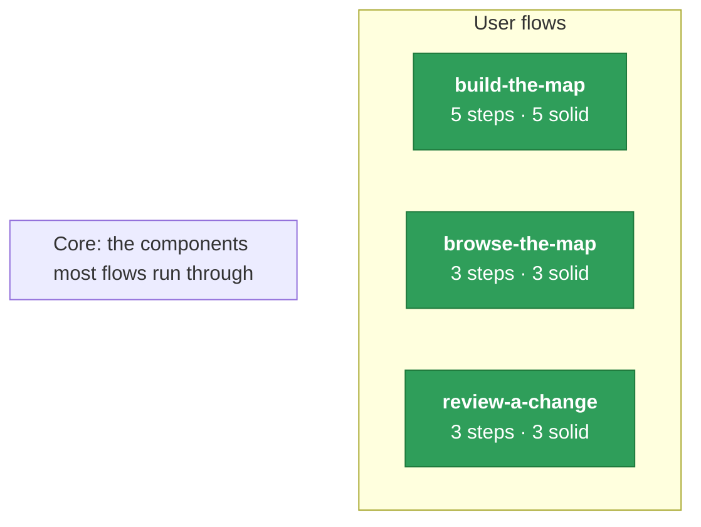

# System map

_Generated by `tools/flowmap/diagrams.py` from `map.json` + the call graph. Do not hand-edit._

Left: user flows (click to drill in), coloured by how much of the flow the map is sure of (green ≥75% of steps tested/agreed · light green ≥50% · amber below). Right: backend components that two or more flows run through. A line means 3+ of that flow's steps reach the component (call graph); its number is how many. Weaker ties are in the matrix. Plumbing reached from most endpoints (auth, sessions) and data classes are hidden so the lines mean something.

## Shared components, widest first

A component many flows run through is where a change has the widest blast radius — and where the system's real core is.

Every component two or more flows share. Cell = how many of the flow's steps reach it.

| component | build-the-map | browse-the-map | review-a-change |
|---|---|---|---|

**workflow engine** = `executor.run_workflow` and everything only it reaches: .

**Hidden as plumbing:** `analytics`, `auth`, `config`, `db`, `logging`, `sentry`, `serialisation`, `settings` (override with `plumbing` in `decisions.json`).

## Flows

- [build-the-map](./build-the-map.md) — Map a repo as flows -> steps -> code by agreement: list its entry points, hand briefs to independent passes, check their citations, and vote them into one map a human settles.
- [browse-the-map](./browse-the-map.md) — See the settled map: Mermaid diagrams at system/flow/step zoom, the interactive atlas, and the left-to-right canvas of screens, steps, code and data.
- [review-a-change](./review-a-change.md) — Turn a PR into a change page: chapters anchored to the map saying where it sits, what it changes, why, and what to ask, backed by facts and linkable from the PR body.
