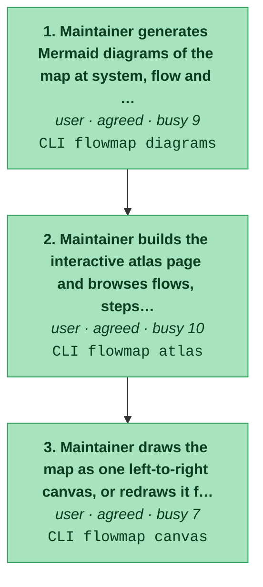
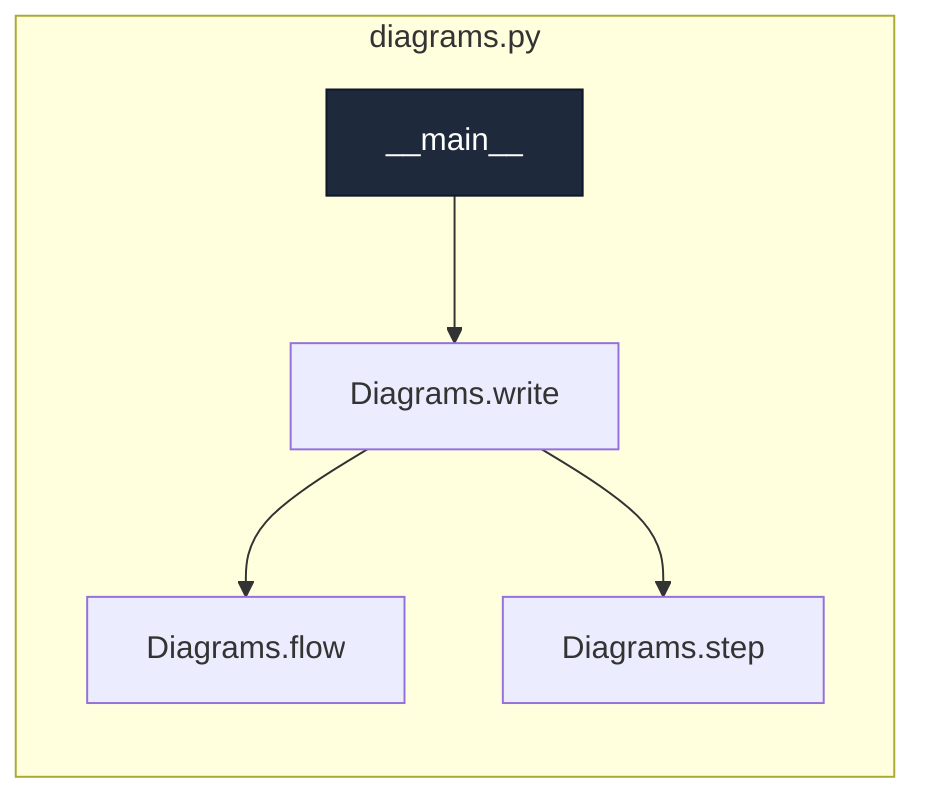
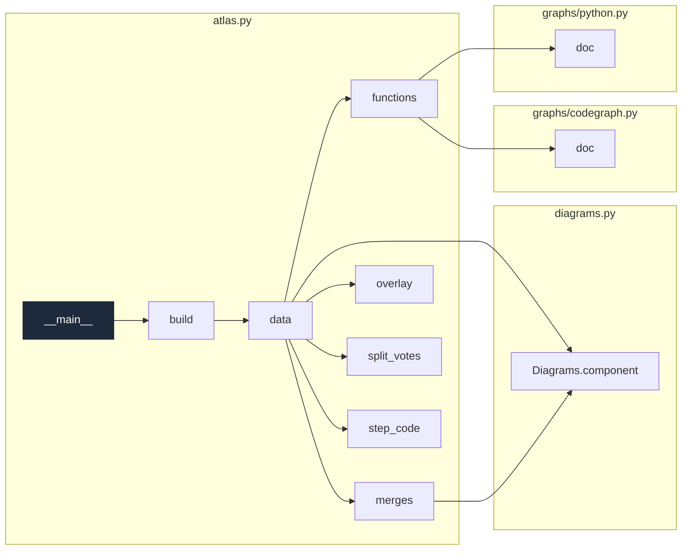
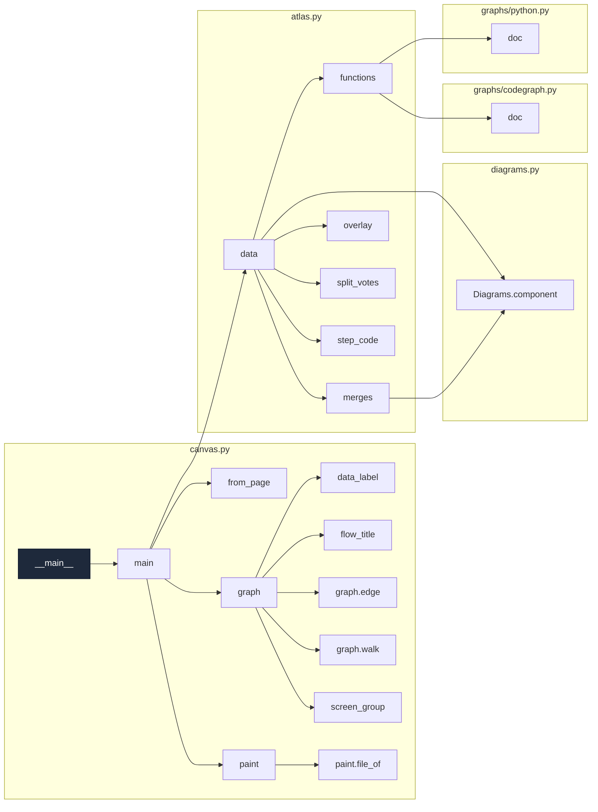

# browse-the-map

_See the settled map: Mermaid diagrams at system/flow/step zoom, the interactive atlas, and the left-to-right canvas of screens, steps, code and data._

[← system map](./README.md) · generated, do not hand-edit

Steps in the order a user meets them. Colour = evidence (dark green confirmed/tested → light green agreed → amber contested → red single-source). Each box lists the endpoints the step calls.

## Code flow per step

Call graph from the step's endpoint handler(s) (dark), grouped by file, depth ≤ 4, plumbing hidden. More boxes and files = a busier step.

### 1. Maintainer generates Mermaid diagrams of the map at system, flow and step zoom

`agreed` · actor user · `CLI flowmap diagrams`
· writes `docs/flowmap/diagrams/<flow>.md`, `docs/flowmap/diagrams/README.md`

code flow

### 2. Maintainer builds the interactive atlas page and browses flows, steps, merges and code

`agreed` · actor user · `CLI flowmap atlas`
· writes `docs/flowmap/atlas.html`

code flow

### 3. Maintainer draws the map as one left-to-right canvas, or redraws it from an existing atlas page

`agreed` · actor user · `CLI flowmap canvas`
· writes `docs/flowmap/canvas.html`

code flow

