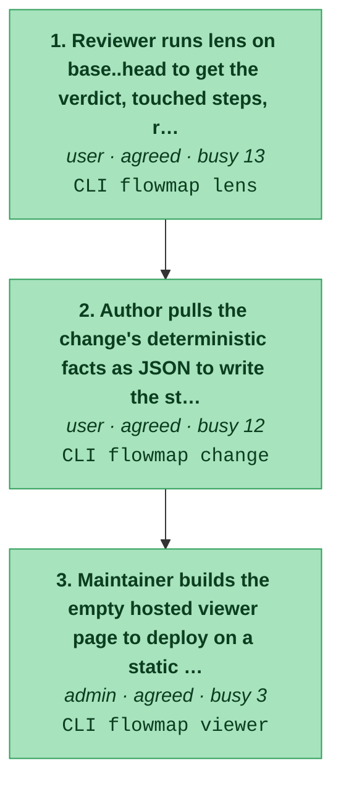
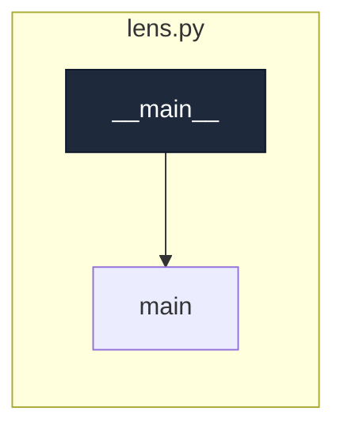
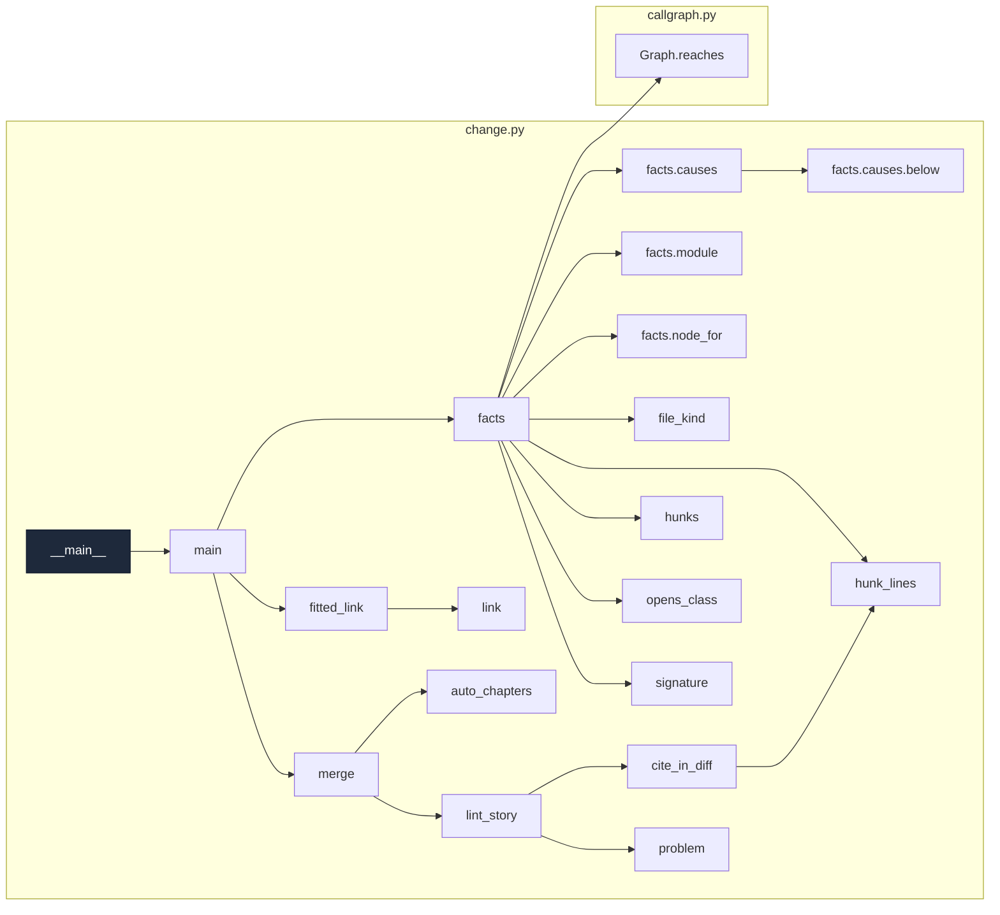
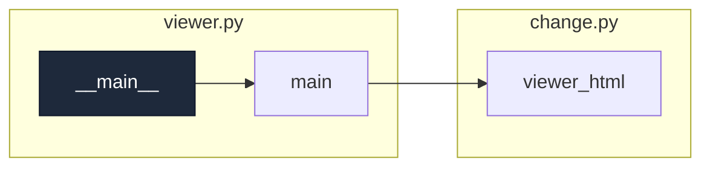

# review-a-change

_Turn a PR into a change page: chapters anchored to the map saying where it sits, what it changes, why, and what to ask, backed by facts and linkable from the PR body._

[← system map](./README.md) · generated, do not hand-edit

Steps in the order a user meets them. Colour = evidence (dark green confirmed/tested → light green agreed → amber contested → red single-source). Each box lists the endpoints the step calls.

## Code flow per step

Call graph from the step's endpoint handler(s) (dark), grouped by file, depth ≤ 4, plumbing hidden. More boxes and files = a busier step.

### 1. Reviewer runs lens on base..head to get the verdict, touched steps, reach and blind spots

`agreed` · actor user · `CLI flowmap lens`

code flow

### 2. Author pulls the change's deterministic facts as JSON to write the story from

`agreed` · actor user · `CLI flowmap change`
· writes `docs/flowmap/changes/<name>.html`

code flow

### 3. Maintainer builds the empty hosted viewer page to deploy on a static host

`agreed` · actor admin · `CLI flowmap viewer`
· writes `<dir>/change.html`

code flow

